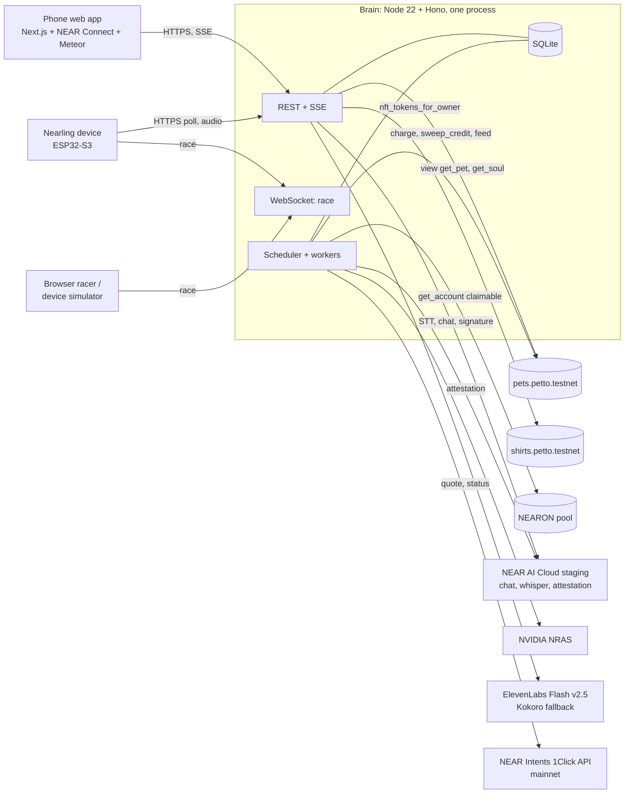

# 01. Overview

## 1. Responsibilities (Build Spec "Backend" + `CLAUDE.md` 8)

| Area | What the brain does | Build Spec |
|---|---|---|
| Identity | NEP-413 sessions for phones, device tokens for Nearlings | 1 |
| Pairing | Pairing sessions, QR tokens, binding device to pet after physical confirm | 1 |
| Talk | STT, Soul fetch, private-model chat, TTS, memory, receipts with TEE verification | 2 |
| Fuel | Pre-check budget, one `charge` per completed reply, retry safety | 2, 3 |
| Feed the Brain | Orders, Intents quote and settlement tracking, `feed(pet)` once per order | 3 |
| Care | Idempotent sync of offline care events, winged evolution | 4, 5 |
| Closet | Shirt ownership check on sync, equipped shirt | 5 |
| Arena | Race rooms, seed, start clock, result validation | 6 |
| Wallet | Balances, one-use approval requests, tx status tracking | 7, 8 |
| Brain Garden | Hourly `sweep_credit` when worth it, show credit | 9 |
| Reach out first | 15 min scheduler, inbox | `CLAUDE.md` 5.5 |

The brain never holds user funds and never signs for users. It signs only `charge`, `credit`, `sweep_credit` (brain account) and `feed` (feeder account).

## 2. Context



## 3. Tech stack

| Concern | Choice |
|---|---|
| Runtime | Node 22, TypeScript strict, ESM |
| HTTP | Hono 4 on `@hono/node-server`; SSE via `streamSSE`; WebSocket via `@hono/node-ws` |
| DB | SQLite (`better-sqlite3`) + `drizzle-orm` + drizzle-kit migrations |
| Validation | `zod` (env, request bodies, chain views) |
| NEAR | `near-api-js` 7 (`JsonRpcProvider`, `FailoverRpcProvider`, `Account`, `KeyPairSigner`, `nep413.verifyMessage`) |
| NEAR AI | native `fetch` (exact bytes for signature checks), multipart via `FormData` |
| Crypto | Node `crypto` (AES-256-GCM, HKDF, randomBytes), `ethers` (EIP-191 recovery), `jose` (JWT) |
| Audio | WAV header parse in-house; no ffmpeg on the device path (device sends 16 kHz WAV; web sends WEBM, whisper accepts it) |
| Tests | `vitest`; `MOCK_AI=1` only in tests |
| Shared code | `packages/shared` (types, constants), `packages/race` (deterministic race rules) |

## 4. Module map (`brain/src/`)

```
server.ts            wiring, CORS, error mapper, boot
config.ts            zod env
db/schema.ts, db.ts  drizzle schema + migrations
log.ts               structured logs, content deny-list
auth/
  session.ts         nonce, NEP-413 verify, JWT
  device.ts          device token check, binding lookup
chain/
  near.ts            providers, getPet (5 s cache), getSoul (cache by version), config cache
  signer.ts          brain account (FC keys pool) + feeder account
  txqueue.ts         serial queue per key, retries, receipt log parsing
ai/
  nearai.ts          chat (raw bytes), transcribe, model list, billing costs
  verify.ts          attestation cache, per-reply signature check
  tts.ts             TtsProvider: elevenlabs | kokoro | none
talk/
  chat.ts            pipeline (03)
  prompt.ts          safety core + Soul + state + memory
  memory.ts          encrypted turns, summary, facts
fuel/
  fuel.ts            budget -> fuel, low fuel, display_state
  charge.ts          charge jobs
  orders.ts          Feed the Brain orders (04)
  intents.ts         1Click client
  garden.ts          sweep_credit job
device/
  pairing.ts         pairing sessions (firmware is the client)
  care.ts            care events, evolution
  closet.ts          shirt sync and equip
  approvals.ts       wallet and transfer approval requests
race/
  rooms.ts           room lifecycle, ws handlers
  validate.ts        replay with packages/race
proactive/
  rules.ts, scheduler.ts, inbox.ts
routes/              one file per route group, thin
```

## 5. Accounts and keys

| Account | Network | Key on server | Used for |
|---|---|---|---|
| `brain.petto.testnet` (= `config.brain`) | testnet | 4 function-call keys, receiver `pets-v8`, methods `charge`, `credit`, `sweep_credit` | Billing, corrections, sweeps |
| `feeder.nearling.testnet` | testnet | 1 full access key, balance kept small (top up manually) | `feed(pet)` for settled orders |
| Project settlement account (mainnet) | mainnet | **none** (receive only) | NEAR Intents destination; brain only reads status |
| NEAR AI org | staging | API key | Chat, whisper, attestation, billing |
| TTS | n/a | API key (ElevenLabs) | Voice |

Contract upgrades (`pets-vN`) need new FC keys for the brain because FC keys are bound to one receiver (`CLAUDE.md` 14, S5 note). The deploy checklist includes "add brain keys for the new contract".

## 6. Deployment

- One Fly.io (or Railway) machine with a volume for `nearling.db`; HTTPS for the device; WebSockets allowed.
- One instance only: rate limits, per-pet locks, race rooms and SSE fan-out are in memory.
- Daily copy of the DB file (memories, orders).
- Local: `pnpm --filter brain dev`, same `.env`.

## 7. Environment (`.env.example`, names only)

```
NEAR_NETWORK=testnet
NEAR_RPC_URLS=https://test.rpc.fastnear.com,https://rpc.testnet.near.org
PETS_CONTRACT=pets.petto.testnet
SHIRTS_CONTRACT=shirts.petto.testnet
DEMO_PETS_CONTRACT=pets-demo.petto.testnet
NEARON_POOL=mw-pool-1024.testnet
BRAIN_ACCOUNT_ID=brain.petto.testnet
BRAIN_KEYS=                       # comma-separated ed25519 FC keys
FEEDER_ACCOUNT_ID=feeder.nearling.testnet
FEEDER_KEY=
NEARAI_BASE_URL=https://cloud-stg-api.near.ai/v1
NEARAI_API_KEY=
NEARAI_CHAT_MODEL=z-ai/glm-5.3-flash
NEARAI_STT_MODEL=openai/whisper-large-v3
TTS_PROVIDER=elevenlabs           # elevenlabs (default) | kokoro (fallback) | none
TTS_MODEL=eleven_flash_v2_5
TTS_API_KEY=
TTS_VOICE_ID=
INTENTS_MODE=direct               # direct | live | simulated
ONECLICK_BASE_URL=https://1click.chaindefuser.com
ONECLICK_JWT=                     # optional, avoids 0.2% fee
SETTLEMENT_ACCOUNT_MAINNET=
MEMORY_MASTER_KEY=
SESSION_JWT_SECRET=
WEB_ORIGIN=https://mypetto.xyz
PUBLIC_WEB_URL=https://mypetto.xyz   # used inside device QR codes
GLOBAL_DAILY_SPEND_CAP_USD=5
MOCK_AI=0
```

Both pets contracts are served by one brain: every pet id is `(contract, token_id)`, so the demo-speed pets work with the same code (02, `pet_ref`).
