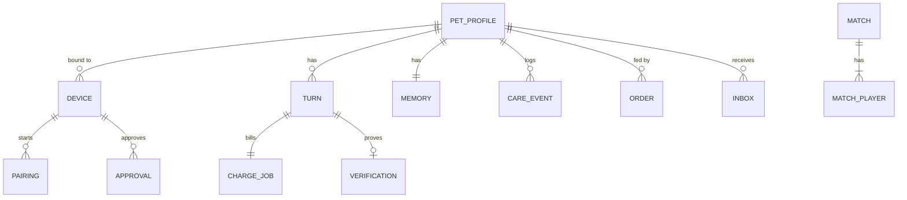

# 02. Data model (SQLite)

Covers the Build Spec "Shared records": device and pairing session, pet and prompt version, care and outfit state, fuel ledger, chat turn and receipt, payment order, match and result, wallet approval request. Durable ids everywhere so callbacks, retries and polling can repeat safely.

Conventions: ids are UUIDv7 strings unless noted; times are unix ms; `enc` = AES-256-GCM blob (`iv|ct|tag`) with a per-pet key; amounts are strings (yocto, micro).

**Pet reference:** `pet_ref = "<contract>:<token_id>"`, e.g. `pets-v8.nearling.testnet:3`. Lets one brain serve `pets-v8` and `pets-demo`.

## 1. Entity overview



## 2. Tables

### Identity and devices

```
auth_nonce     (nonce PK, expires_at)
session        -- stateless JWT, no table

device         (id PK, hw_id UNIQUE, secret_hash, token_hash UNIQUE NULL,
                pet_ref NULL, owner_account NULL, bound_at NULL, revoked_at NULL,
                last_seen_at, fw_version)
pairing        (id PK, device_id, token UNIQUE (random 128-bit, in QR), status
                 'open'|'claimed'|'awaiting_confirm'|'confirmed'|'expired'|'cancelled',
                pet_ref NULL, owner_account NULL, created_at, expires_at)
```

### Pet profile (off-chain state keyed by NFT identity)

```
pet_profile    (pet_ref PK, owner_account,             -- last seen owner; mismatch = transfer
                nickname enc NULL, owner_tz,
                form 'base'|'winged', evolved_at NULL,
                care_milestones json  {pat:bool, rock:bool, sleep:bool},
                care_mood int,                          -- 0..100, device-local care mood (Q3)
                equipped_shirt NULL,                    -- shirts token id
                last_owner_turn_at, created_at)
```

### Talk

```
turn           (id PK = usage_ref, pet_ref, owner_account, device_id NULL,
                request_id, channel 'device'|'web', status 'processing'|'done'|'failed'|'canned',
                user_text enc, reply_text enc, emotion,
                soul_version, model, inference_id, chat_id,
                prompt_tokens, completion_tokens, provider_cost_nano,
                stt_ms, llm_ms, tts_ms, audio_key NULL,
                created_at, completed_at,
                UNIQUE (pet_ref, request_id))           -- D3 retry idempotency
memory         (pet_ref + owner_account PK, summary enc, facts enc,
                turns_since_summary, archived_at NULL)
verification   (turn_id PK, status 'model_verified'|'gateway_verified'|'unverified'|'pending',
                signature_kind, req_hash, resp_hash, signer, attestation_id, reason,
                public bool default 0)                  -- opt-in public evidence
attestation    (id PK, model, nonce, fetched_at, ok, model_signers json, gateway_signer, nras json)
audio_blob     (key PK, turn_id, mime, bytes BLOB, expires_at)   -- TTS output, 24 h TTL
```

### Fuel and orders

```
charge_job     (turn_id PK, pet_ref, cost_micro, status 'queued'|'sent'|'settled'|'failed',
                attempts, tx_hash NULL, charged_micro NULL, source NULL, last_error NULL)
order          (id PK, pet_ref, mode 'direct'|'live'|'simulated', pack_id,
                payer_hint NULL, quote json NULL, deposit_address NULL,
                status 'created'|'quoted'|'pending'|'settled'|'feeding'|'fed'|'failed'|'refunded'|'expired',
                feed_yocto, feed_tx NULL UNIQUE, settle_ref NULL UNIQUE,
                created_at, updated_at)
spend_daily    (day PK, provider_nano, tts_chars)
```

### Care, closet

```
care_event     (id PK = device-generated UUID, pet_ref, device_id, kind 'pat'|'rock'|'shake'|'sleep',
                at, received_at)                        -- idempotent by id
```

Closet ownership is not stored; it is read from `shirts` on each sync (`equipped_shirt` is cleared when no longer owned).

### Arena

```
match          (id PK, code UNIQUE (6 chars), rules_version, seed, start_at NULL,
                status 'lobby'|'countdown'|'running'|'finished'|'interrupted', result json NULL)
match_player   (match_id + slot PK, kind 'device'|'browser', device_id NULL, pet_ref NULL,
                display_name, ready, crash_tick NULL, inputs json, disconnected_at NULL)
```

### Wallet approvals

```
approval       (id PK, kind 'send'|'stake'|'transfer_pet', network 'testnet',
                account_id, device_id, pet_ref NULL,
                receiver_id, amount_yocto NULL, token_id NULL, validator NULL,
                status 'requested'|'approved'|'signed'|'final'|'rejected'|'expired'|'failed',
                tx_hash NULL UNIQUE, created_at, approved_at NULL, expires_at)
```

### Proactive

```
inbox          (id INTEGER PK, pet_ref, owner_account, trigger, text enc, turn_id NULL,
                created_at, delivered_device_at NULL, read_at NULL)
proactive_day  (pet_ref + day PK, count, fired json)
pet_event      (id PK, pet_ref, kind, actor, amount, tx_hash UNIQUE, block_ts, raw json)  -- timeline
```

## 3. Retention

- `audio_blob`: 24 h.
- `turn.user_text`, `reply_text`: kept (memory), encrypted; deleted with `archived_at` + 30 days after transfer.
- Raw request / response bytes for verification: **memory only**, dropped after hashing (Build Spec "verification window" = the request lifetime).
- Logs never contain `enc` fields (09).
