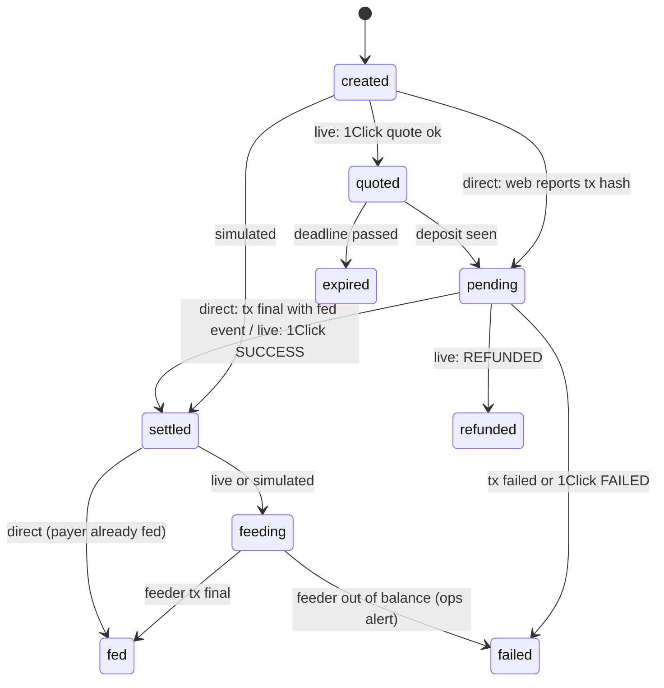

# 04. Fuel, Feed the Brain, Brain Garden

## 1. Fuel model (chain is truth)

| Value | Source |
|---|---|
| Budget | `get_pet.budget_micro` (credit + food in micro-USD, settled) |
| Fuel price | `config().fuel_price_micro` = 1_000 ($0.001) |
| Fuel left | `floor(budget_micro / fuel_price_micro)` |
| Low Fuel | `life_state` in {`Starving`, `Dormant`} or fuel left = 0 |
| Spend per chat | one `charge(pet, fuel_price_micro, usage_ref = turn_id, null, 1, 1)` |
| Passive drain | metabolism, on chain (`daily_burn_micro`) |

Display numbers: starter food 0.1 NEAR at $0.20 = 20 fuel; 1 NEAR = 200 fuel (`CLAUDE.md` 7.2). Demo contract: starves in about 14 min.

### display_state (Q3)

```
if life_state in {Dormant, Starving}  -> chain value          (Low Fuel)
elif life_state == Hungry             -> "hungry"             (fullness < 40)
elif profile.care_mood < 40           -> "sad"                (device-local care, 05)
elif sleeping locally                 -> "sleepy"
else                                  -> "happy"
```

Chain `Sad` / `Sleepy` are ignored because on-chain mood and energy are not the demo path.

## 2. Charge queue (`fuel/charge.ts`, `chain/txqueue.ts`)

- Worker loop picks `charge_job` rows with `status in (queued, sent)` oldest first.
- N = 4 brain FC keys, one serial lane per key (no nonce clashes). Gas 50 Tgas (`CONTRACT_INTERFACE.md`).
- Success: parse `EVENT_JSON` `thought { cost_micro, source }` from receipt logs; store `charged_micro`, `source`, `tx_hash`; status `settled`; SSE `fuel_charged` to the web.
- No `thought` event in a successful tx = repeated `usage_ref` (already charged earlier): mark `settled`, keep the earlier tx if known.
- Failure: backoff 2 s, 10 s, 60 s, 5 min, then every 15 min; `failed` after 24 h with an ops alert. The reply was already delivered; the contract never panics on low funds, so failures are only RPC or key problems.

## 3. Feed the Brain (Build Spec 3, `CLAUDE.md` 8.3b)

One order pipeline, three payment modes (Q1). The QR on the device opens `PUBLIC_WEB_URL/feed/<petRef>`.

| Mode | How the payer pays | What moves fuel | Label |
|---|---|---|---|
| `direct` (default) | Payer's own testnet wallet calls `feed(pet)` with the pack amount via NEAR Connect | The payer's own `feed` tx | none, it is real |
| `live` | NEAR Intents 1Click quote, payer sends from any supported chain (e.g. Solana USDC) to the deposit address; settles to `SETTLEMENT_ACCOUNT_MAINNET` | After settlement, **feeder** calls `feed(pet)` on testnet with the pack's testnet NEAR | "Paid on mainnet, fuel granted on testnet" |
| `simulated` | Button "Pay (simulated)" | Feeder `feed(pet)` | "simulated" (rule 5) |

Every live payment is a mainnet transaction with real money: it needs explicit human approval each time (`CLAUDE.md` rule 1). Start with 1Click `dry: true` quotes only.

### Order state machine



Rules (Build Spec "Done when"):
- **Unique credit per order:** `order.feed_tx UNIQUE`, `order.settle_ref UNIQUE` (1Click deposit tx or direct tx hash). Transition `settled -> feeding` is a single `UPDATE ... WHERE status = 'settled'` so duplicate notifications and page refreshes cannot feed twice.
- Pending, failed, refunded and expired orders never touch fuel.
- Direct mode: the brain verifies the reported tx hash via RPC `tx` status: receiver = pets contract, method `feed`, args pet id, deposit = pack amount, `fed` event present. It does not trust the client.
- After `fed`: SSE `fuel_added` (web), inbox line "Yum! Thanks <payer>!" (device celebrates once, `celebrate_id` = order id).

### 1Click client (`fuel/intents.ts`) [VERIFY against docs before live use]

- `GET /v0/tokens` (supported assets), `POST /v0/quote` (`dry: true` for price display; `dry: false` returns `depositAddress` and `deadline`), `POST /v0/deposit/submit` (optional, speeds detection), `GET /v0/status?depositAddress=` polled every 10 s until `SUCCESS`, `REFUNDED` or `FAILED`.
- Quote stored in `order.quote` (origin asset, amount in, amount out, deadline, quote reference) per Build Spec.
- Destination: NEAR on mainnet to `SETTLEMENT_ACCOUNT_MAINNET`. Check the route minimum and fees before fixing a pack price.

### Packs

| Pack | Testnet feed | Fuel | Live price (indicative) |
|---|---|---|---|
| Snack | 0.1 NEAR | 20 | route minimum, [TBD after quote] |
| Meal | 0.5 NEAR | 100 | [TBD] |
| Feast | 1 NEAR | 200 | [TBD] |

## 4. Feeder account

- `feeder.nearling.testnet`, full access key on the brain, balance 5 to 20 testnet NEAR, topped up by hand.
- Only code path that uses it: `orders.feed(order)`. Hard cap per UTC day (e.g. 10 NEAR) in code.
- Low balance (< 2 NEAR) = ops alert; orders wait in `settled` until topped up.

## 5. Brain Garden (Build Spec 9, `CLAUDE.md` 6)

- Staking is a **wallet** action on the web (`stake`, `unstake`, `withdraw`, 450 Tgas); the brain does not sign it.
- Brain shows: `staked`, `credit_micro`, `daily_credit_micro`, `self_sustaining`, `pending_unstake` from `get_pet`, plus "Credit growing" / "Fuel ready" in fuel units.
- Hourly job: view `mw-pool-1024.testnet.get_account(pets contract)`; call `sweep_credit()` (600 Tgas) only when `claimable ≥ 0.01 CREDIT`. "Nothing to claim" panic is logged and ignored. After a sweep, read the NEAR AI org balance and record it (ops page).
- Withdraw may fail with "funds not collected yet": the web shows "processing, retry later" (`CONTRACT_INTERFACE.md`).
