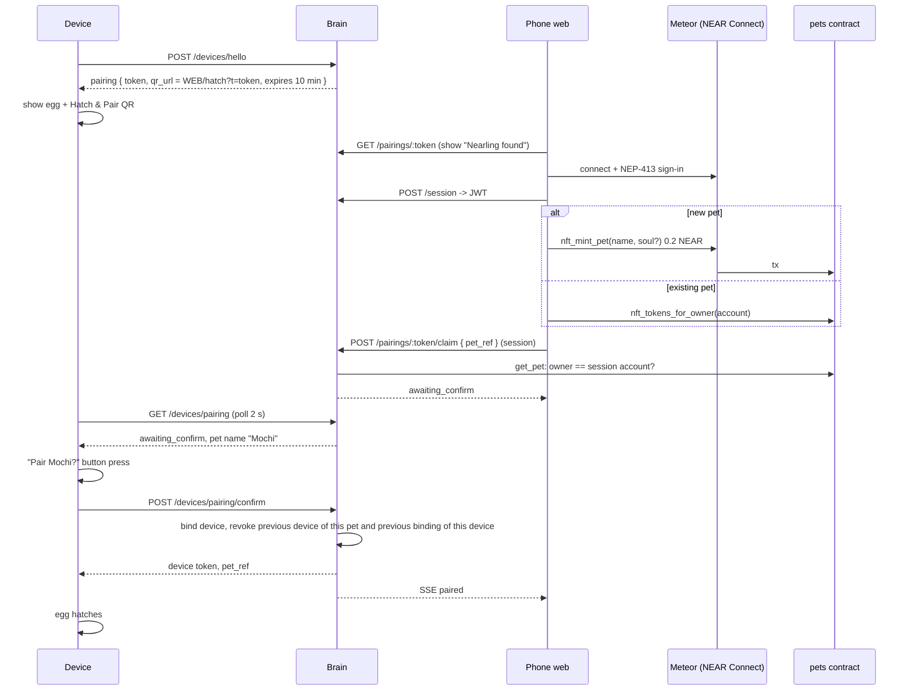
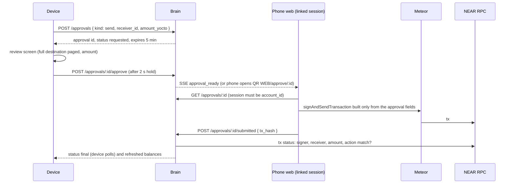

# 05. Devices, care, Closet, Wallet approvals

I own and build these routes (`pairing.ts`, `approvals.ts`). The hardware teammates build the C++ device client against them (contract: 08).

## 1. Device identity

- First boot: device makes `hw_id` (MAC-based) and a random 32-byte `device_secret`, stored in NVS.
- `POST /devices/hello { hw_id, device_secret, fw_version }`: first call registers `secret_hash`; later calls must present the same secret. Returns the current binding (or none) and opens a pairing session if unbound.
- After pairing the device gets a **device token** (random 32 bytes, stored hashed). Header `Authorization: Device <token>`.
- Token valid only while `device.pet_ref` is set, not revoked, and `pet_profile.owner_account == get_pet.owner` (checked with the 5 s cache). Transfer = automatic revoke.

## 2. Hatch & Pair (Build Spec 1)

Rules: token single use; expires in 10 min; `claim` only from `open`; `confirm` only from `awaiting_confirm` by the same device; used or expired token cannot bind (Build Spec "Done when"). Replacement device: same flow with "existing pet"; old device revoked.

## 3. Offline care sync (Build Spec 4, 5)

- Device runs care fully offline (firmware). It queues events `{ id (UUID), kind: pat|rock|shake|sleep, at }`.
- `POST /pets/:petRef/care { events: [...] }` on reconnect; `INSERT OR IGNORE` by `id` (idempotent).
- Brain updates `care_mood` (pat +5, rock +3, sleep restores, shake -2, decay -2 per hour, clamp 0..100) and `care_milestones` (pat, rock, sleep).
- **Evolution:** when all three milestones are true and `form = base`, set `form = winged`, `evolved_at`, inbox "I grew wings!" once. Response includes `{ form, evolved_now }`. A replacement device loads `form` from `/state`.
- The browser simulator posts to the same route with `device_id = null`, `source = web-sim` so judges can evolve a pet without hardware.
- No chain writes for care (hybrid 1.1).

## 4. Closet (Build Spec 5)

- Claim is on the phone: `shirts.claim()` with 0.01 NEAR (web, wallet tx).
- `GET /pets/:petRef/closet`: brain calls `shirts.nft_tokens_for_owner(owner)`; returns owned shirts and `equipped_shirt`; clears `equipped_shirt` if no longer owned (transfer).
- `POST /pets/:petRef/closet/equip { token_id | null }` (device or session): only an owned token; stored on `pet_profile`.
- Device draws the shirt as a sprite layer (firmware).

## 5. Wallet approvals (Build Spec 7, 8)

The device starts and reviews; the phone builds and Meteor signs. Bound to network, account, device, action, destination and exact amount; one use; expires.

| Kind | Tx the phone builds | Brain verification |
|---|---|---|
| `send` | `Transfer(amount)` to `receiver_id` | signer = account, receiver = receiver_id, single Transfer of exact amount |
| `stake` | `deposit_and_stake()` on a verified testnet validator pool, deposit = amount | receiver = validator, method, deposit |
| `transfer_pet` (stretch) | `nft_transfer(receiver_id, token_id)` on pets, 1 yocto | receiver = pets, method, args; then device revoked on next owner check |

Rules: changing amount or destination = new request; `approve` only from `requested`, before expiry, by the bound device; `submitted` only once (`tx_hash UNIQUE`); rejected / expired / replayed requests stop. Saved recipients: per-owner list on the brain (`GET/POST /wallet/recipients`), so the device picks, never types.

Balances: `GET /wallet` (device or session) returns liquid (`view_account`) and staked (`get_account_staked_balance` on the configured validator pool).

The on-chain approval flow (`CLAUDE.md` 7.3) is kept in the contract but not used here.
