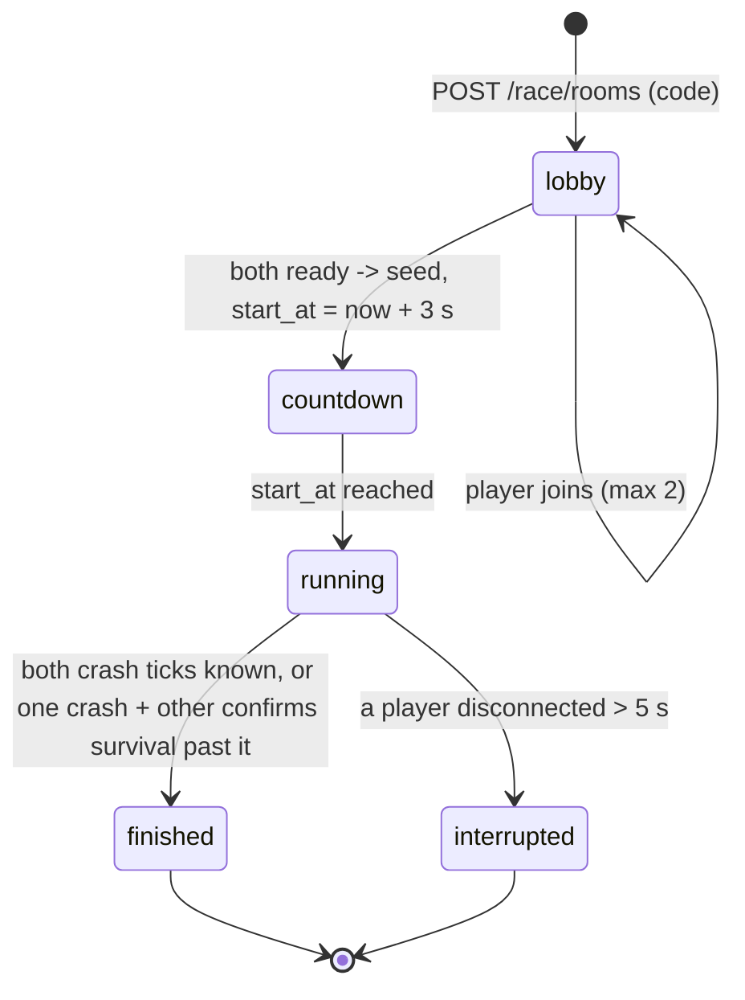

# 06. Battle Arena: Nearling Run (Build Spec 6)

Two pets race on one shared course; one control (switch lane). Device vs browser first, two devices when both exist. Off chain, free entry.

## 1. Shared rules (`packages/race`, ported to C++ by the hardware teammates)

The rules are the contract between brain, browser and firmware. Version them: `RULES_VERSION = 1`. Any change bumps the version; the server rejects clients on another version.

| Rule | Value (v1, tune after bench tests) |
|---|---|
| Fixed step | 30 ticks per second (33.3 ms) |
| Lanes | 2 (0, 1); pet starts in lane 0 |
| PRNG | mulberry32(seed), uint32 seed from the server |
| Obstacle spawn | every `gap(t)` ticks, lane = top bit of the uint32 `rng()` (`rng() >>> 31`, no floats); `gap` starts at 45 ticks and shrinks by 1 every 150 ticks to a floor of 15 |
| Speed | `speed(t) = 2 + floor(t / 300) * 0.5` px per tick, cap 6 (240 px track) |
| Collision | obstacle reaches the pet row (y ≥ 200 and y < 200 + 16) while in the pet's lane |
| Lane switch | input applied at the next tick boundary; instant |
| Result | first crash tick loses; same tick = draw; no crash in 120 s = draw |

Reference implementation: `packages/race/src/index.ts` (step order: lane switch, spawn, move, collide). Golden vectors the C++ port must reproduce: `packages/race/src/index.test.ts` (`GOLDEN`). Sketch:

```ts
export function mulberry32(a: number) { return () => { a |= 0; a = (a + 0x6D2B79F5) | 0;
  let t = Math.imul(a ^ (a >>> 15), 1 | a); t = (t + Math.imul(t ^ (t >>> 7), 61 | t)) ^ t;
  return ((t ^ (t >>> 14)) >>> 0) / 4294967296; }; }
export function simulate(seed: number, inputs: number[] /* ticks of lane switches */, maxTicks: number): number | null
// returns crash tick or null
```

Use integer maths for positions (fixed point, px x 100) so floats never differ between Node and ESP32.

## 2. Room lifecycle



## 3. WebSocket protocol

`GET /race/ws?code=ABC123` upgraded; auth by `Authorization: Device <token>` (device) or a short-lived `race_token` from `POST /race/rooms/:code/join` (browser, no wallet needed for the demo opponent).

Client to server:

| Message | Fields |
|---|---|
| `hello` | `rules_version`, `name`, `pet_ref?` |
| `ready` | |
| `ping` | `t_client` |
| `lane` | `tick`, `lane` |
| `crash` | `tick`, `inputs` (all switch ticks) |

Server to client:

| Message | Fields |
|---|---|
| `room` | players, slots, ready flags |
| `pong` | `t_client`, `t_server` (clients estimate offset, keep the median of 5) |
| `start` | `seed`, `start_at` (server ms), `rules_version` |
| `opp_lane` | `slot`, `tick`, `lane` (relay for rendering only) |
| `result` | `winner_slot` or `draw`, `crash_ticks`, `reason` |
| `interrupted` | `reason` |

Local pet moves immediately on button press; the opponent's lane changes render when `opp_lane` arrives (late or out of order is fine because the outcome comes from ticks, not arrival order).

## 4. Result validation (`race/validate.ts`)

- On `crash`, the server replays `simulate(seed, inputs, tick + 1)` and checks the crash tick matches. Mismatch = that player's report is invalid; the server uses its own replay of their inputs.
- A player who never reports a crash: the server waits until the other's crash tick + 2 s of race clock, then asks for inputs (`crash` with `tick = null` is allowed as "still alive") and replays.
- Same crash tick = draw; disconnect > 5 s = `interrupted`, no winner (Build Spec).
- Results stored in `match`; inbox line for each pet ("I won the race!"). No fuel prizes (Build Spec: separate decision).

## 5. Browser opponent

`web` page `/race` uses the same `packages/race` and the same protocol, so a judge can race a device or another browser tab.
