# Nearling: Architecture

An AI pet that lives on NEAR and pays for its own brain. One pet, two bodies (web app and ESP32 device), one brain service, one on-chain state.

> **Superseded for the device, brain and web (2026-11-11).** This document was written before the hybrid scope and before the brain and web were built. It still describes a touch-screen device that signs its own transactions and on-chain approvals as the demo path; that is no longer true. Read these instead:
>
> | Part | Current source |
> |---|---|
> | Contract (fuel, NEARON, Soul, events, caps) | `CLAUDE.md` 6 and 7, [`docs/CONTRACT_INTERFACE.md`](docs/CONTRACT_INTERFACE.md); sections 4.1, 4.2, 5.1, 5.2, 5.5 and 6.1 below are still accurate |
> | Brain as built | [`AI-brain architectual/`](AI-brain%20architectual/README.md), routes in [`08-api-reference.md`](AI-brain%20architectual/08-api-reference.md) |
> | Web as built | [`web-app architectual/`](web-app%20architectual/README.md), route list in `CLAUDE.md` 9 |
> | Device and product | [`docs/Nearling-Hackathon-Build-Spec.md`](docs/Nearling-Hackathon-Build-Spec.md) |
> | Deployment | [`docs/DEPLOY.md`](docs/DEPLOY.md) (brain on Fly.io with a SQLite volume, web on Vercel) |
>
> As built, in short: the **device** is an ESP32-S3 with a 240x240 screen, three buttons, a touch pad, motion and light sensors and a speaker; it holds no chain key in the demo path. It pairs by QR (`/hatch`), talks through the brain, keeps care offline, races over a WebSocket, and approves wallet actions with a physical hold, after which the owner signs in **Meteor** on the phone. The **brain** (Node 22, Hono, SQLite, one machine) owns talk with verified receipts, the charge queue (one fuel per reply), Feed the Brain orders, the Garden sweep, pairing, care, Closet, approvals, race rooms and the proactive inbox. The **web** (Next.js 16, NEAR Connect) covers adopt, pet home with a browser Nearling, receipts, feed, Closet, Soul, Garden, race and the public page.

**Scope update 2026-11-09:** the team adopted the hybrid scope in `CLAUDE.md` 1.1: product features and hardware from `docs/Nearling-Hackathon-Build-Spec.md`, fuel kept on chain. Where this document describes on-chain care stats, on-device signing or the on-chain approval flow as the demo path, those are now kept in code but not demoed; fuel, NEARON, the pet NFT and the transfer rules below still hold.

Status: **draft for team review** (2026-11-08). Contract parts updated 2026-11-09 by Role 1 to match the contract as built (milestones M1 to M4, deployed at `pets-v5.nearling.testnet`) and the S5 / S6 spike results in `CLAUDE.md` 14. `CLAUDE.md` is the spec and wins on any conflict. Items marked [VERIFY] depend on spikes S1 to S7; items marked [PROPOSAL] need agreement from the owning role. Deep dives for web and brain are in [conceptual/](conceptual/README.md).

---

## 1. Overview

### 1.1 What each part does

| Part | Owner | Role in one line |
|---|---|---|
| **Pets contract** (`contract/`) | Role 1 | Source of truth: NFT ownership, budget (food + credit), stake, stats, stage, traits, items, device key, approvals |
| **Brain service** (`brain/`) | Role 2 | The pet's mind: chat, memory, persona, billing each thought, proactive messages, TEE verification, pairing host |
| **Web app** (`web/`) | Role 2 | Adopt, care, chat, fund, pair the device, public pet page, privacy proof |
| **Device** (`firmware/`) | Roles 3 + 4 | Physical body: sprite on a touch screen, pet by touch, hold to talk, alerts, signs `play` / `stake_from_food` / `approve_action` with its own limited key |
| **NEAR AI Cloud** | external | Private (TEE) model inference and speech-to-text, OpenAI-compatible |
| **NEARON** | external | Stakes NEAR, mints iNEAR, accrues CREDIT that tops up the brain's NEAR AI org |

### 1.2 System context

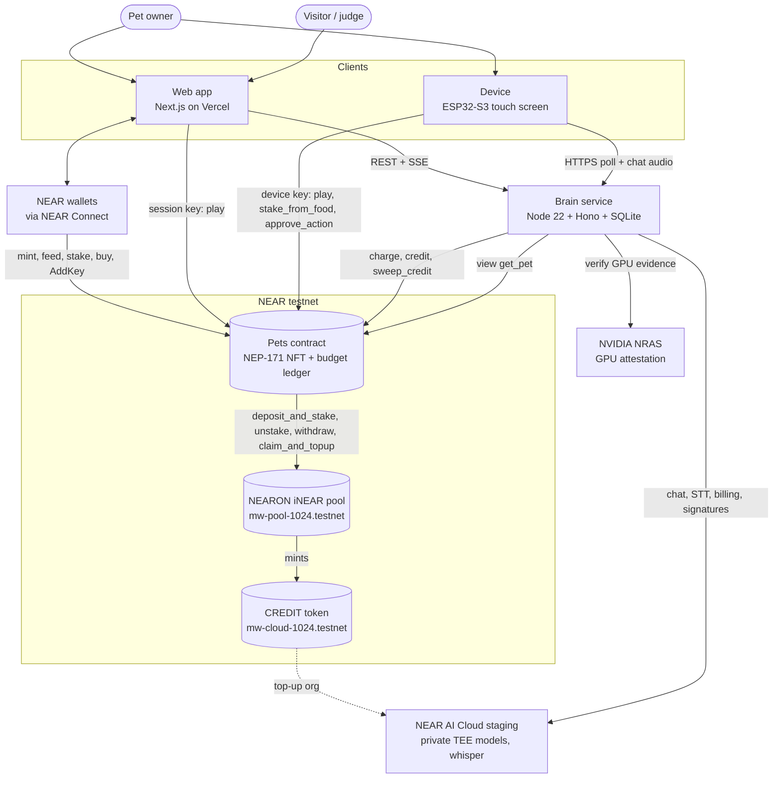

### 1.3 Architectural principles

1. **Chain is truth for value and pet stats; brain is truth for words.** The brain never holds user funds and never signs for users.
2. **Web and device are thin clients.** Neither talks to NEAR AI directly.
3. **Lazy settlement.** Stats, credit accrual and metabolism are computed from timestamps on every read and write; nothing runs on a timer on chain.
4. **The game loop has no wallet popups.** Chat is paid by the pet (brain sends the tx), care actions are signed by a limited session key. Only value moves open the wallet.
5. **Least privilege keys everywhere.** Brain, browser session and device all use function-call access keys that cannot move funds out.
6. **Every thought is real, priced and provable.** Private model only, cost charged on chain, reply signature verified against TEE attestation.

---

## 2. Tech stack

| Layer | Choice | Version / note |
|---|---|---|
| Monorepo | pnpm workspaces | `brain`, `web`, `packages/shared`; Rust and firmware live alongside |
| **Contract** language | Rust | `near-sdk` 5.x, `near-contract-standards` (NEP-171, 177, 181, 297/256 events) |
| Contract build / deploy | `cargo-near` 0.23, `near-cli-rs` 0.31 | `cargo near build non-reproducible-wasm` (Rust 1.99 output deploys fine); `scripts/deploy-testnet.sh` |
| Contract tests | `cargo test` (unit) | Every rule, including each NEARON callback driven with mocked success / failure results; NEARON itself is exercised against the real pool on testnet (no stub pool) |
| **Brain** runtime | Node.js 22, TypeScript strict | One long-running process |
| Brain HTTP | Hono 4.x | REST + SSE (`streamSSE`) |
| Brain storage | SQLite via `better-sqlite3` + `drizzle-orm` | File on a persistent volume |
| Brain NEAR client | `near-api-js` 7.x | `JsonRpcProvider` / `FailoverRpcProvider`, `MultiKeySigner` [VERIFY], `nep413.verifyMessage` |
| Brain AI client | native `fetch` (not the OpenAI SDK for chat) | Keeps exact request / response bytes for signature checks |
| Brain crypto | Node `crypto` (AES-256-GCM, HKDF), `ethers` (EIP-191 signer recovery), `jose` (JWT) | |
| Validation | `zod` 4.x | Env, routes, model JSON output |
| Tests | `vitest` | `MOCK_AI=1` only in tests |
| **Web** framework | Next.js 16 App Router, React, TypeScript | Hosted on Vercel |
| Web styling / data | Tailwind CSS, TanStack Query | |
| Wallet | `@hot-labs/near-connect` 0.12, `near-connect-hooks` | HOT, Meteor, Intear, MyNearWallet, Nightly, NEAR Mobile, OKX, WalletConnect; optional Privy plugin [VERIFY S3] |
| Web tx signing (session key) | `near-api-js` 7.x in the browser | Function-call key limited to `play` |
| **Device** board | ESP32-S3 with capacitive touch colour screen, I2S mic, speaker (M5Stack CoreS3 class) | [TBD after S4] |
| Device framework | PlatformIO, Arduino framework | |
| Device graphics | `M5Unified` / `M5GFX` or `LovyanGFX` (LVGL optional) | [TBD Role 3] |
| Device networking | `WiFiClientSecure`, `HTTPClient`, `ArduinoJson` | HTTPS to brain and NEAR RPC |
| Device crypto | ed25519 (libsodium in ESP-IDF or Monocypher), SHA-256 (mbedTLS) | Borsh encoder hand-written for one `FunctionCall` action |
| Device storage | NVS (`Preferences`), flash encryption + secure boot in demo build | Device token, ed25519 key |
| AI provider | NEAR AI Cloud staging `https://cloud-stg-api.near.ai/v1` | Chat `openai/gpt-oss-120b` (alt `z-ai/glm-5.3-flash`, `Qwen/Qwen3.6-35B-A3B-FP8`) [VERIFY S1]; STT `openai/whisper-large-v3` |
| Staking to AI credit | NEARON testnet | iNEAR pool `mw-pool-1024.testnet`, CREDIT `mw-cloud-1024.testnet` |
| RPC | `https://test.rpc.fastnear.com`, `https://rpc.testnet.near.org` | Failover |
| Hosting | Vercel (web), Fly.io or Railway single machine + volume (brain) | HTTPS required by the device |

---

## 3. Repository and module layout

```mermaid
flowchart LR
  subgraph repo[nearling/]
    SH[packages/shared<br/>TS types + constants]
    WEBM[web/]
    BRM[brain/]
    CON[contract/]
    FW[firmware/]
    ART[art/<br/>sprites.png + sprites.json]
    SC[scripts/<br/>deploy, seed]
  end
  SH --> WEBM
  SH --> BRM
  ART --> WEBM
  ART --> FW
  CON -. ABI: method names, args, events .-> WEBM
  CON -. .-> BRM
  CON -. .-> FW
  SC --> CON
```

Shared contracts between teams: contract method signatures and events (Role 1), brain routes and `packages/shared` types (Role 2), `art/sprites.json` format (Role 3), pairing and device auth (Role 4).

---

## 4. Static structure (UML)

### 4.1 Contract data model (class diagram)

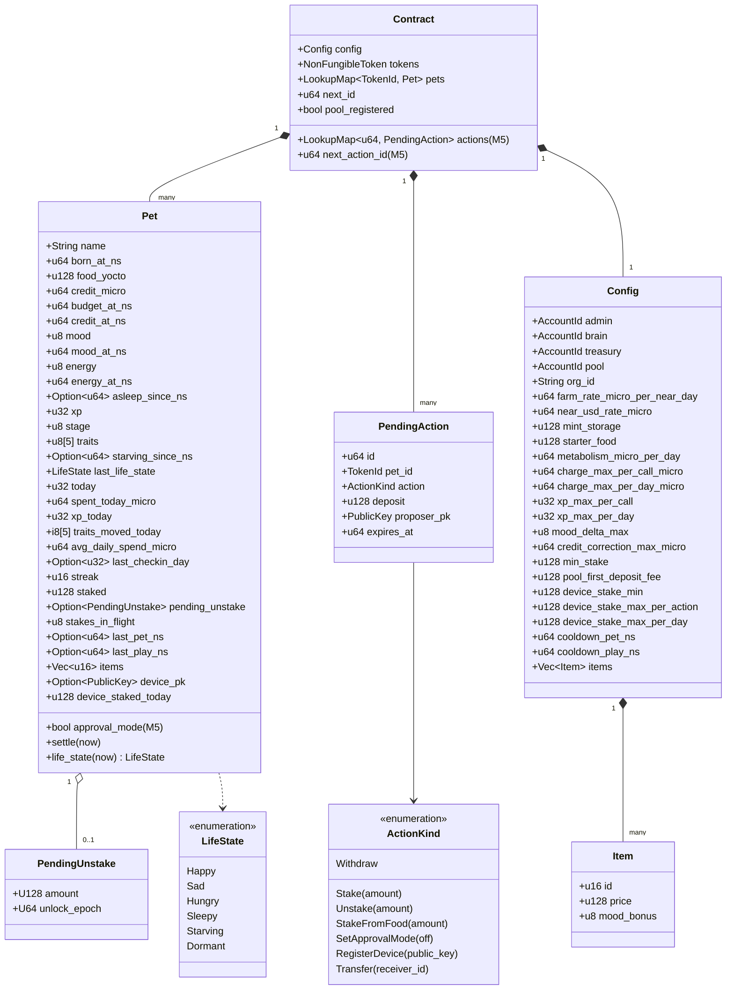

Notes on the model as built:
- The pet id is the map key; the **owner is not stored in `Pet`**, it comes from the NFT core (`tokens.owner_by_id`), so it can never go stale after a transfer.
- Each lazy value has its own as-of time (`budget_at_ns`, `credit_at_ns`, `mood_at_ns`, `energy_at_ns`), advanced only by the time it actually used. A single `last_tick_ns` would round decay away when writes are frequent (caught by a test).
- `today` is the UTC day index; the daily counters (`spent_today_micro`, `xp_today`, `traits_moved_today`, `device_staked_today`) reset when it rolls, and `avg_daily_spend_micro` becomes `(avg × 3 + yesterday) / 4`.
- `pool_registered`: NEARON keeps a one-time 0.0055 NEAR fee from the contract's first deposit ever, so that first stake is recorded as `amount - fee`; `staked` always equals iNEAR held.
- `stakes_in_flight`: stakes sent to the pool whose callback has not run; transfer waits for them.
- `persona_hash` is not stored yet (who writes it is open, ask C5).
- `get_pet` returns a separate JSON `PetView` (u64 timestamps and u128 amounts as strings): `id, owner, name, born_at_ns, food_yocto, credit_micro, budget_micro, fullness, mood, energy, asleep_since_ns, xp, stage, traits, starving_since_ns, life_state, staked, pending_unstake, daily_credit_micro, self_sustaining, items, device_pk`.

### 4.2 Contract methods by caller

| Caller (checked how) | Methods |
|---|---|
| Admin (`predecessor == config.admin`) | `new`, `set_config` |
| Owner wallet (`predecessor ==` NFT owner) | `nft_mint_pet` (0.2 NEAR), `stake`, `unstake`, `withdraw`, `play`, `buy_item`, `register_device`, `set_approval_mode` (M5), `propose_action` (M5), `cancel_action` (M5), `nft_transfer` |
| Device (`predecessor ==` NFT owner and `signer_account_pk == pet.device_pk`) | `play`, `stake_from_food`, `approve_action` (M5) |
| Brain (`predecessor == config.brain`) | `charge`, `credit` |
| Anyone | `feed`, `sweep_credit`, all views |
| Views | `get_pet` (settled, plus `life_state`, `self_sustaining`), `get_pending_actions`, `nft_tokens_for_owner`, `nft_tokens`, `config` |

Gated by approval mode (only through `propose_action` + device `approve_action`): `stake`, `unstake`, `withdraw`, `register_device`, `set_approval_mode(false)`, `nft_transfer`.

### 4.3 Brain modules (component diagram)

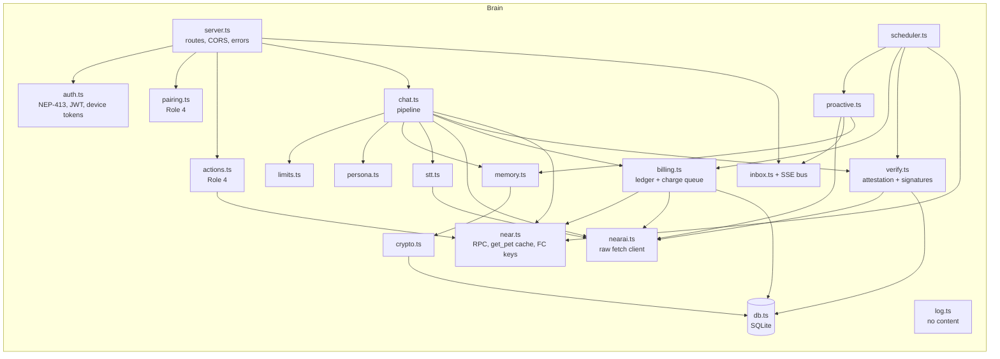

### 4.4 Brain data model (entity relationship)

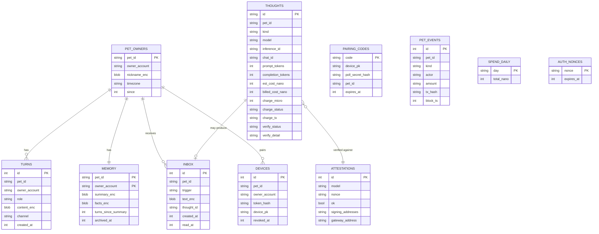

`_enc` columns are AES-256-GCM with a per-pet key derived by HKDF from `MEMORY_MASTER_KEY`.

### 4.5 Web structure

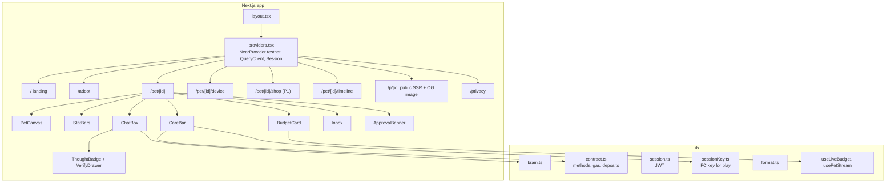

### 4.6 Firmware structure

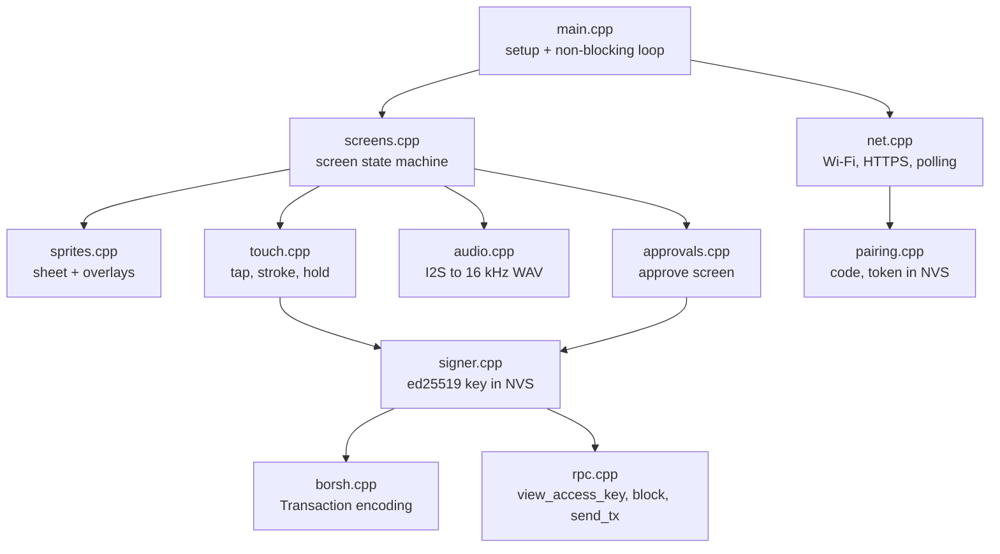

---

## 5. Dynamic behaviour (UML)

### 5.1 Pet life states (state machine)

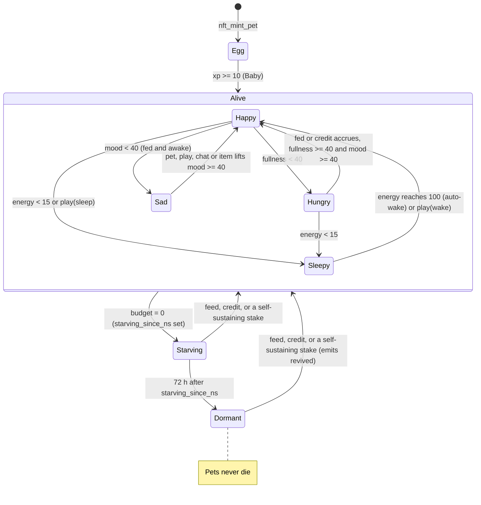

Precedence when several hold (first match wins): Dormant > Starving > Sleepy (also while asleep) > Hungry > Sad > Happy. A stake revives a starving pet only when it is **self-sustaining** (daily credit ≥ metabolism + average spend); a smaller accrual is eaten by metabolism, so the 72 h dormant clock keeps running. `dormant` / `revived` are emitted on the next write that observes the change; `revived` only when leaving Dormant. A new pet starts at mood 80, energy 100.

Growth is orthogonal to life state: `Egg -> Baby -> Teen -> Adult` at xp 10 / 100 / 500, emits `stage_up`.

### 5.2 Lazy settlement order (activity)

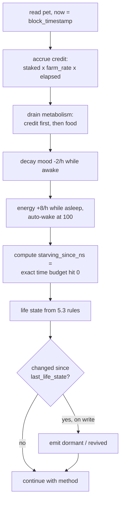

### 5.3 Adopt and sign in

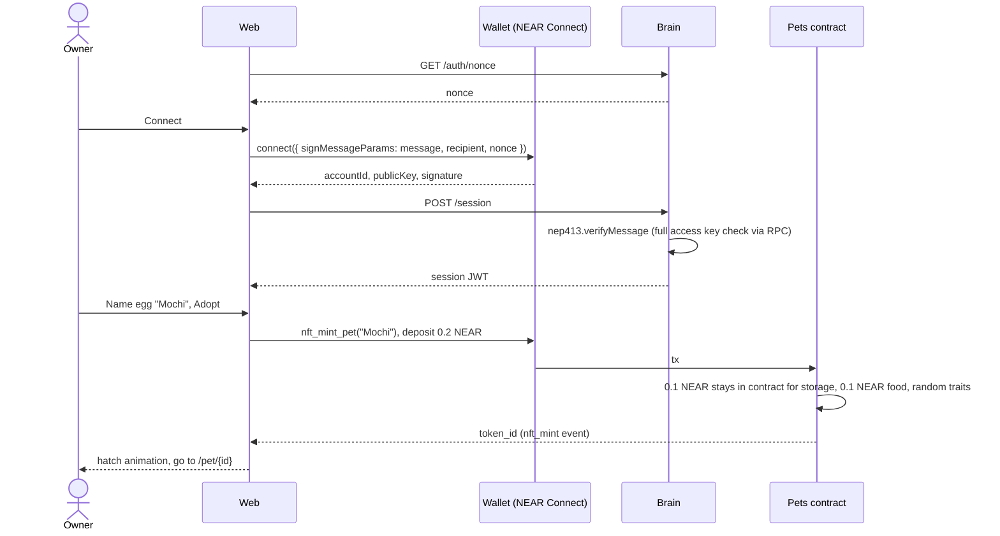

### 5.4 Chat turn (pet pays, reply verified)

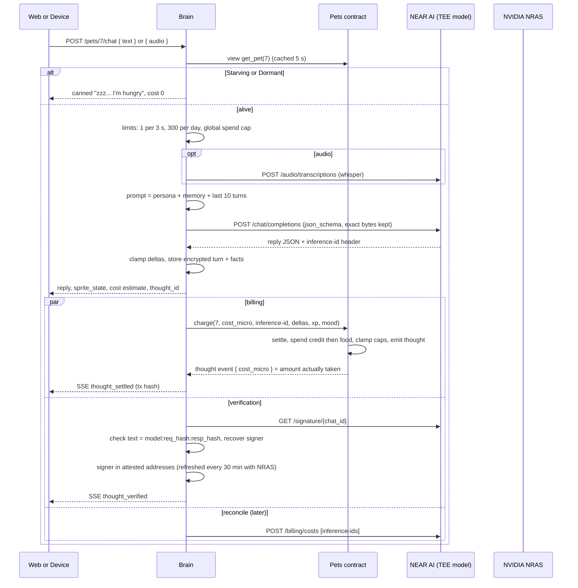

### 5.5 Stake to live (NEARON, Option A)

```mermaid
sequenceDiagram
  actor U as Owner
  participant W as Web
  participant C as Pets contract
  participant P as NEARON pool
  participant B as Brain
  participant AI as NEAR AI org
  U->>W: Stake 10 NEAR
  W->>C: stake(pet_id) deposit 10 NEAR, 450 Tgas (needs >= 430; max per tx 1000 Tgas, S6)
  C->>P: deposit_and_stake() with 10 NEAR
  alt success
    P-->>C: ok
    C->>C: callback: pet.staked += 10 (first deposit ever: minus 0.0055 NEAR pool fee), emit staked
  else failure
    P-->>C: error
    C->>U: callback refunds 10 NEAR
  end
  loop every block (lazy)
    C->>C: credit_micro += staked x farm_rate x elapsed
  end
  loop hourly
    B->>C: sweep_credit()
    C->>P: claim_and_topup(config.org_id)
    P-->>AI: CREDIT top-up to brain org
  end
  Note over W: BudgetCard ticks credit up live, Self-sustaining badge when daily credit >= daily burn
```

Unstake: `unstake(pet_id, amount)` locks the amount at call time (one pending unstake per pet) and calls the pool's `unstake` with **exactly 1 yocto** attached; a failed call restores it. The pool may pay at once from its buffer or queue for `current + 2` epochs (12 to 24 h), and does not say which, so the contract **always treats it as pending** until `unlock_epoch`. `withdraw(pet_id)` after that calls the pool's `withdraw()` (also **exactly 1 yocto**; returns the amount paid, 0 if the buffer already paid) and pays the owner only that pet's amount. `claim_and_topup` returns no value (with 0 claimable it succeeds and does nothing), so the brain reads the org balance to see what a sweep delivered. All verified on testnet, see `CLAUDE.md` 14.

### 5.6 Device pairing and key registration [PROPOSAL: device shows the code]

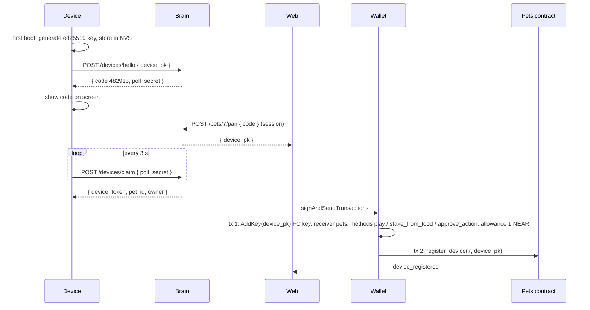

### 5.7 Approve on the device

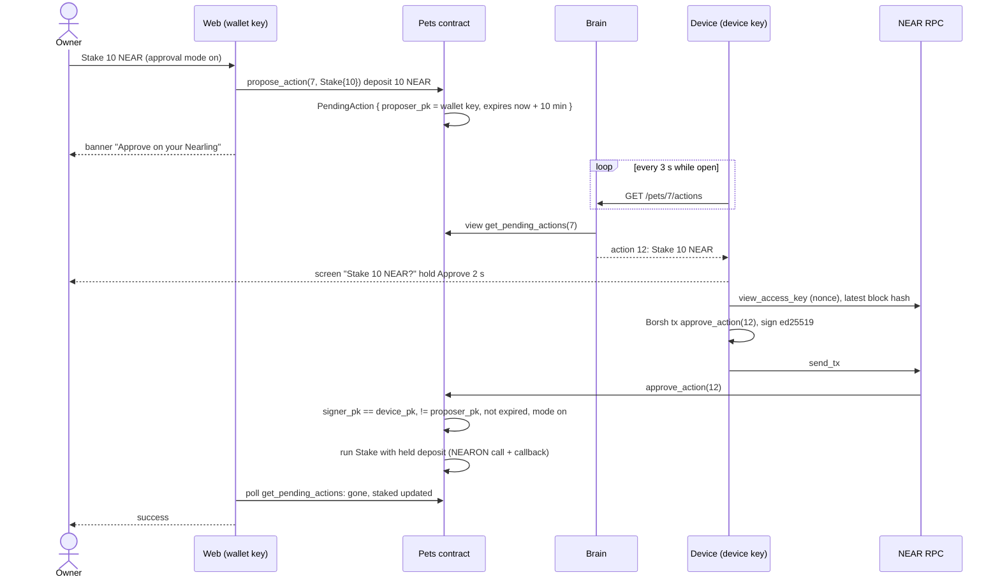

### 5.8 Proactive message

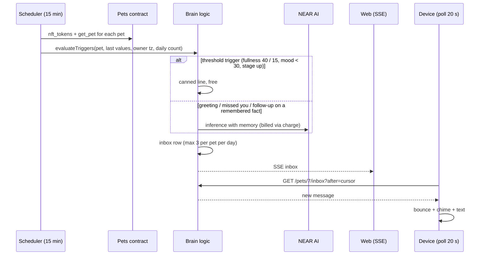

### 5.9 Device screen state machine

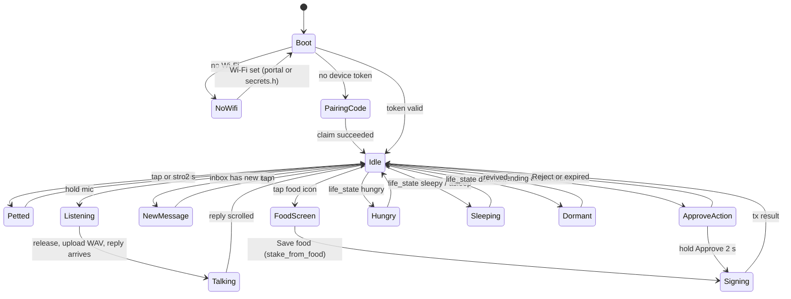

---

## 6. Detailed technical architecture

### 6.1 Contract (`contract/`, Role 1)

**Account:** breaking changes deploy fresh to `pets-vN.nearling.testnet` (no migrations); current: `pets-v5.nearling.testnet` (also in `.env` as `PETS_CONTRACT`). Code-only changes redeploy in place. Proposed extra: `pets-demo.<team>.testnet` with fast metabolism for judges, labelled "demo speed" [PROPOSAL].

**Modules** (`src/`, as built): `lib.rs` (init, config, `get_pet` / `PetView`, load/save with life-state events), `nft.rs` (NEP-171/177/181 via `near-contract-standards` + transfer rules), `pet.rs` (state, pure settlement, life state, stages, traits, play, thought clamping), `budget.rs` (feed, charge, credit), `stake.rs` (NEARON calls + callbacks, sweep), `play.rs`, `device.rs` (`register_device`, `stake_from_food`, `signer_account_pk` checks), `items.rs`, `events.rs` (NEP-297 standard `nearling` v1.0.0). Coming in M5: `approvals.rs`.

**Units:** NEAR in yocto (`u128`, JSON as string), money in micro-USD (`u64`), time in ns (`u64`). Food converts at `near_usd_rate_micro` (start $0.20 / NEAR, testnet rate).

**Charge algorithm (`charge`, brain only, never panics on low funds):**
1. Settle to now.
2. `cost = min(cost, per_call_cap 5_000, daily_cap 100_000 - spent_today, credit + food_in_usd)`.
3. Take from `credit_micro` first, then convert the rest to yocto and take from `food_yocto`; food spent goes to `treasury`.
4. If short, set starving (exact time).
5. Clamp deltas: xp ≤ 5 per call and ≤ 50 per day (check-in bonus on top), mood ±10, traits ±2 per trait per day (0 to 100). Each chat costs 3 energy.
6. Care XP: first owner interaction per UTC day gives +2 xp and extends the streak.
7. Emit `thought { pet_id, cost_micro, usage_ref }` with the amount actually charged; `stage_up` if a threshold crossed. Only thought spending goes to the treasury; food burnt by metabolism stays in the contract.

Proposed additions [PROPOSAL, Role 1]: reject repeated `usage_ref` (idempotent retries); include `source` (credit / food / mixed) in `thought`; stable panic prefixes (`E_COOLDOWN`, `E_NOT_OWNER`, `E_APPROVAL_MODE`, `E_STAKED`).

**Cross-contract calls (NEARON pool `mw-pool-1024.testnet`):**

| Pets method | Pool call | Callback |
|---|---|---|
| `stake` / approved `Stake` / `stake_from_food` | `deposit_and_stake()` with NEAR, 400 Tgas | success: `staked +=` (minus the one-time pool fee on the first deposit ever); failure: refund owner (or return food); `stakes_in_flight` -1 either way |
| `unstake` / approved `Unstake` | `unstake(amount)`, 1 yocto, 400 Tgas; amount locked before the call | success: emit `unstaked`; failure: restore stake, clear `pending_unstake` |
| `withdraw` / approved `Withdraw` | `withdraw()`, 1 yocto, 400 Tgas (pays all matured to contract) | success: pay owner only this pet's amount, emit `unstake_withdrawn`; failure: keep it pending |
| `sweep_credit` | `claim_and_topup(config.org_id)`, 400 Tgas (whether to call `sync_from_farm` first: ask C9) | emit `credit_swept { org_id, result }` (the pool returns no amount) |

Callers must attach ≥ 430 Tgas (400 for the pool call, 20 for the callback).

S6 settled Option A: max gas per tx on testnet is 1000 Tgas, so the pool call plus callback fits, also from the device key.

**Security invariants:** only brain can `charge` / `credit` (capped); only admin changes config; only owner stakes and receives withdrawals; `sweep_credit` can only target `config.org_id`; device key cannot attach deposits and can only call three methods; proposer key cannot approve its own action (M5); transfer blocked while staked, unstaking or a stake is in flight; transfer clears device key (and pending actions, M5).

**Storage:** mint price covers pet storage (asserted in tests), no NEP-145.

### 6.2 Brain (`brain/`, Role 2)

Full design: [conceptual/03-brain-design.md](conceptual/03-brain-design.md).

**Routes:**

| Route | Auth | Purpose |
|---|---|---|
| `GET /auth/nonce` [PROPOSAL] | none | NEP-413 challenge |
| `POST /session` | NEP-413 | Session JWT (7 days) |
| `GET /pets/:id/state` | public | Settled stats, life state, sprite, budget, days left, self-sustaining |
| `POST /pets/:id/chat` | session or device | Text or WAV in, reply + cost + sprite out |
| `GET /pets/:id/inbox` | session or device | Proactive messages since cursor |
| `GET /pets/:id/stream` [PROPOSAL] | session | SSE: state, inbox, thought_settled, thought_verified, action_pending |
| `GET /pets/:id/timeline` [PROPOSAL] | public | Per-NFT history |
| `GET /thoughts/:id/verification` [PROPOSAL] | public | Hashes, signer, attestation, no content |
| `GET /attestation` [PROPOSAL] | public | Latest TEE attestation summary |
| `POST /pets/:id/pair`, `POST /devices/hello`, `POST /devices/claim` | session / none / poll secret | Pairing (Role 4) |
| `GET /pets/:id/actions` | device | Pending actions for approve screen (Role 4) |

**Chat pipeline:** auth -> `get_pet` (5 s cache) -> transfer check -> canned if starving -> limits -> STT -> prompt (fixed core, pet sheet, now, memory, last 10 turns) -> one private-model call with JSON schema output `{ reply, sprite_state, mood_delta, xp_gain, trait_deltas, remember[], nickname }` -> clamp -> store encrypted -> respond -> async charge + verify.

**Billing:**
- `cost_nano = prompt_tokens x in_price + completion_tokens x out_price`, prices from `GET /v1/model/list` (nano-USD per token), refreshed hourly.
- `charge_micro = ceil(cost_nano / 1000)`.
- Serial charge queue over **4 function-call keys** on the brain account (receiver pets, methods `charge`, `credit`, `sweep_credit`); no full access key on the server.
- Retry with backoff; reconcile with `POST /v1/billing/costs` by `inference-id`; correct over-charges with capped `credit`.
- Guards: 1 thought per 3 s, 300 per day per pet; global daily USD cap; NEAR AI 402 = global "brain resting", never marks a pet starving.

**Verification:** every 30 min fetch `/v1/attestation/report` with a fresh 32-byte nonce, verify GPU evidence at NVIDIA NRAS (`x-nvidia-overall-att-result`, `eat_nonce`), cache verified signing addresses. Per reply: SHA-256 of exact request and response bytes, fetch `/v1/signature/{chat_id}`, check signed text and recover the EIP-191 signer, match `provider_tee` to model attestation or `gateway` to gateway attestation. TDX quote is linked, not verified in app (stated honestly) [VERIFY staging supports these endpoints].

**Memory:** last 10 turns, summary rewritten every 20 turns (billed "dreaming" thought), up to 30 facts with optional `follow_up_on` dates. AES-256-GCM, key per pet via HKDF. On transfer: archive old owner's memory, revoke devices, reset nickname.

**Scheduler (single process, `setInterval` with overlap guard):** 15 min proactive rules (max 3 per pet per day, quiet hours by owner timezone, billed pings skipped below fullness 15); hourly `sweep_credit`; 1 min billing reconcile; 30 s timeline event tail; 30 min attestation refresh.

**Logging:** ids, costs, tokens, timings, tx hashes, statuses only. A deny-list drops `text`, `reply`, `facts`, `summary`, `nickname`, audio.

### 6.3 Web app (`web/`, Role 2)

Full design: [conceptual/04-web-design.md](conceptual/04-web-design.md).

**Credentials in the browser:**

| Credential | Signs | Popup? |
|---|---|---|
| Wallet (NEAR Connect, testnet, `signMessage` filter) | mint, feed, stake, unstake, withdraw, buy, AddKey, register device, approval mode, propose / cancel action, transfer | yes |
| Brain session JWT (from NEP-413 at connect) | brain API calls | no |
| Session key (browser ed25519 FC key, methods `play`, allowance 0.25 NEAR) | `play(pet, pet / play / sleep / wake)` | once, to add the key |

**Transactions:**

| Action | Method | Deposit | Gas |
|---|---|---|---|
| Adopt | `nft_mint_pet(name)` | 0.2 NEAR | 50 Tgas (about 3 Tgas burnt on testnet) |
| Feed (anyone) | `feed(pet_id)` | 0.1 / 0.5 / 1 NEAR | 30 Tgas |
| Stake | `stake(pet_id)` or `propose_action(Stake)` | ≥ 1 NEAR | 450 Tgas (≥ 430 required) |
| Unstake / Withdraw | `unstake` / `withdraw` or proposal | 0 (the contract attaches the pool's 1 yocto itself) | 450 Tgas |
| Pet / Play / Sleep / Wake | `play` via session key | 0 | 30 Tgas |
| Buy item (P1) | `buy_item` | catalog price | 30 Tgas |
| Device setup | `AddKey` + `register_device` (one batch) | 0 | 30 Tgas |
| Transfer | `nft_transfer` | 1 yocto | 30 Tgas, disabled while staked, unstaking or a stake is in flight |

**Rendering:** landing, `/p/[id]` (with OpenGraph image) and `/privacy` are server components reading the public brain API; everything wallet related is client side. `PetCanvas` draws the shared sprite sheet on a pixelated canvas with item overlays and particles. `useLiveBudget` interpolates credit accrual and metabolism between fetches so the budget ticks every second. Each pet message shows cost, billing status (queued -> tx link) and a "Verified in TEE" badge with a drawer of checks.

### 6.4 Device (`firmware/`, Roles 3 + 4)

**Hardware:** ESP32-S3, capacitive touch colour screen, I2S mic, speaker or buzzer, USB-C (M5Stack CoreS3 class) [TBD after S4].

**Main loop:** non-blocking, `millis()` timers, one state machine per screen (section 5.9). Network calls run in a FreeRTOS task so animation never stalls.

**Networking:**
- Wi-Fi via captive portal (P1) or `secrets.h`.
- HTTPS to the brain with `Authorization: Device <token>` [PROPOSAL].
- Poll `/state`, `/inbox` and `/actions` every 20 s, every 3 s while an approval is open.
- Chat: hold the mic, record ≤ 10 s at 16 kHz mono 16-bit (about 320 KB), multipart `audio` to `/chat`; the reply scrolls as text (no TTS).

**Touch:** tap or stroke the sprite = local purr + hearts, counted locally, synced as `play(pet, "pet")` at most once per 5 min. The food icon opens budget and days left; "Save food" calls `stake_from_food` (1 to 2 NEAR, only shown when food ≥ 1 NEAR plus one day of burn). The approve screen needs a 2 s hold.

**On-device signing (P1, spike S5):**
1. First boot: generate an ed25519 keypair, store the private key in NVS (flash encryption + secure boot in the demo build).
2. Per tx: RPC `query view_access_key` (nonce) and `block final` (hash) on testnet.
3. Borsh-encode `Transaction { signer_id = owner, public_key = device_pk, nonce + 1, receiver_id = pets, block_hash, actions: [FunctionCall { method, args JSON, gas, deposit 0 }] }`.
4. SHA-256, sign with ed25519, Borsh `SignedTransaction`, base64, RPC `send_tx`.
5. Methods: `play`, `stake_from_food`, `approve_action`. Gas comes from the key's 1 NEAR allowance; top it up from the web.

Fallback if S5 slips: the brain relays `play`, approvals stay web-only, labelled in README.

**Rendering:** 64×64 pixel sprites from `art/sprites.json` (frame rects, per stage and state, item anchors), scaled to fit; screens: idle, happy, being-petted, talking, listening, eating, hungry, sleepy, sleeping, dormant, new-message, approve-action, signing, no-wifi, pairing-code.

---

## 7. Security architecture

### 7.1 Keys and what they can do

| Key | Lives in | Type | Can call | Cannot |
|---|---|---|---|---|
| Owner wallet key | user's wallet | full access | everything as owner | approve its own proposed action |
| Browser session key | `localStorage` | FC, receiver pets, `play`, 0.25 NEAR allowance | `play` | deposits, any other method |
| Device key | device NVS | FC, receiver pets, `play` / `stake_from_food` / `approve_action`, 1 NEAR allowance | care actions, capped food -> stake, approvals | deposits, sending funds anywhere |
| Brain keys (x4) | brain env | FC on brain account, receiver pets, `charge` / `credit` / `sweep_credit` | capped charges and corrections | move brain account NEAR, change config |
| Admin key | team, offline | full access on admin account | `set_config`, rotate brain | |
| NEAR AI API key | brain env | Bearer | inference within org balance | |

### 7.2 Threats and mitigations

| Threat | Mitigation |
|---|---|
| Brain compromised, drains pets | `charge` capped at $0.005 per call and $0.10 per pet per day; brain keys are FC only |
| Stolen browser wallet key under approval mode | Value actions need a device approval; `register_device` is gated so the thief cannot swap in their own device key |
| Stolen device | Device key cannot attach deposits; `stake_from_food` moves the pet's own food into its own stake, capped per action and per day |
| Old owner keeps access after transfer | Contract checks `predecessor == current owner`; device key cleared; brain re-checks owner on every request and revokes device tokens |
| Brain repeats a charge on retry | Idempotent `usage_ref` [PROPOSAL] |
| Chat content leaks | Private TEE models only (boot check rejects `verifiable=false`), encrypted memory, no content in logs |
| Fake inference | No mocks outside `MOCK_AI=1` tests; per-reply TEE signature verification shown in UI |
| Team overspends on NEAR AI | Global daily spend cap in brain; NEARON CREDIT pays first |

Honest limits (README): NEARON is a prototype with an upgradeable owner key; staging API and prices; the brain operator can read memories; the ESP32 is not a secure element; TDX quote not verified in app.

---

## 8. Deployment architecture

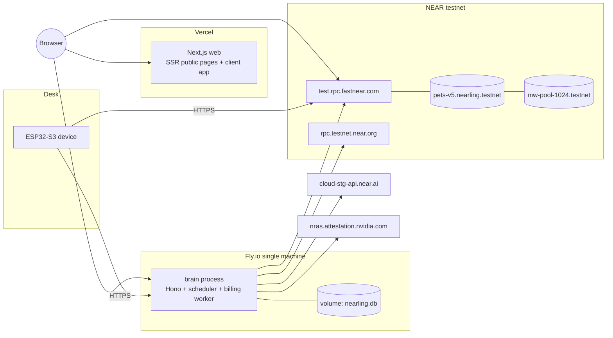

- One brain instance (rate limits, nonces and SSE bus are in-process). Daily SQLite backup because it holds memories.
- Local run for judges: `pnpm --filter brain dev` and `pnpm --filter web dev` with `.env` from `.env.example`; contract via `./scripts/deploy-testnet.sh` then `./scripts/seed-demo.sh` (pets in every life state).

**Configuration (all from env, never committed):**

| Service | Variables |
|---|---|
| Brain | `NEAR_NETWORK`, `NEAR_RPC_URLS`, `PETS_CONTRACT_ID`, `BRAIN_ACCOUNT_ID`, `BRAIN_KEYS`, `NEARAI_BASE_URL`, `NEARAI_API_KEY`, `NEARAI_CHAT_MODEL`, `NEARAI_STT_MODEL`, `MEMORY_MASTER_KEY`, `SESSION_JWT_SECRET`, `WEB_ORIGIN`, `GLOBAL_DAILY_SPEND_CAP_USD`, `MOCK_AI` |
| Web | `NEXT_PUBLIC_BRAIN_URL`, `NEXT_PUBLIC_PETS_CONTRACT_ID`, `NEXT_PUBLIC_NEAR_NETWORK`, `NEXT_PUBLIC_WALLETCONNECT_PROJECT_ID` |
| Firmware (`include/secrets.h`, gitignored) | `WIFI_SSID`, `WIFI_PASS`, `BRAIN_URL`, `PETS_CONTRACT_ID`, `NEAR_RPC_URL` |
| Contract (`set_config`) | `Config` struct, section 4.1 |

---

## 9. Cross-cutting concerns

| Concern | Approach |
|---|---|
| Numbers on the wire | yocto, micro-USD and nano-USD as strings in JSON; firmware parses only what it shows |
| Time | Contract uses block timestamp; brain uses UTC days for caps and the owner timezone for night mode and greetings |
| Consistency | Web refetches `/state` after each tx; brain `get_pet` cache is 5 s; charges are eventually consistent (reply first, charge after) |
| Observability | Structured logs (ids, costs, latency, tx, statuses); ops view of thoughts estimated vs billed, charge failures, NEARON top-ups, attestation status |
| Testing | Contract: unit tests for every rule in CLAUDE.md 16 (NEARON callbacks with mocked results) plus testnet runs against the real pool; brain: vitest with `MOCK_AI=1`, recorded verification fixtures; web: unit tests for formatting and live budget, Playwright smoke on a seeded pet; device: S4 / S5 bench tests and an integration run with the brain |
| Simulated parts | Any fallback (NEARON simulation, demo-speed contract, brain-relayed play) is labelled "simulated" or "demo speed" in UI and README |

---

## 10. Open items

| ID | Question | Owner | Blocks |
|---|---|---|---|
| S1 / S2 | Model latency, cost per reply, JSON output, attestation and signature on staging | Role 2 | Model default, TEE badge |
| S3 | Wallet testnet + signMessage support, session key flow, Privy funding | Role 2 | Onboarding |
| S4 | Board: touch, Wi-Fi, HTTPS, I2S WAV | Roles 3 + 4 | Device |
| S5 | ed25519 + Borsh signing on ESP32. Contract side **done** 2026-11-08: `play` and `stake_from_food` signed by a real limited key work, wallet key rejected, deposits rejected | Role 4 (ESP32), Role 1 (`approve_action` in M5) | Device signing, approvals |
| S6 | **Done** (Option A): max gas 1000 Tgas, first-deposit fee, 1 yocto on unstake / withdraw, farm rate 657 µ$/NEAR/day. Open: real `claim_and_topup` into the org (needs org id and ≥ 0.01 CREDIT) | Roles 1 + 2 | Self-sustaining top-up |
| S7 | CREDIT top-up into the staging org, whisper on staging | Roles 1 + 2 | Self-sustaining claim |
| P1 | Pairing direction (device shows code) | Roles 2 + 4 | Pairing |
| P2 | Idempotent `usage_ref`, `thought.source`, panic codes, `persona_hash` writer, demo-speed deploy | Roles 1 + 2 | Billing, UX, demo |
| P3 | New brain routes (stream, timeline, verification, attestation, timezone) | Role 2 with all | Shared interface |
| P4 | Testnet welcome drip for social-login users | Team | Onboarding |
