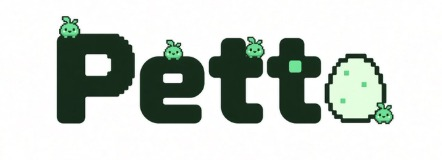
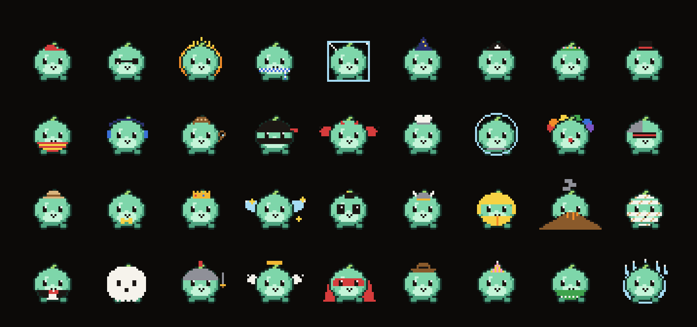
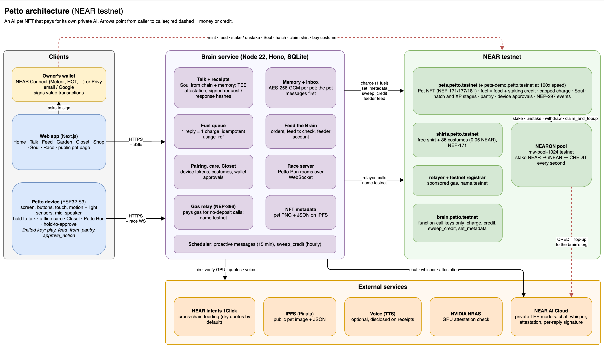

<div align="center">
  
  <p><strong>An AI Tamagotchi that pays for its own thoughts</strong></p>
  <p>
    <a href="https://near.org"></a>
    <a href="https://docs.near.ai"></a>
    <a href="https://stg.nearon.dev"></a>
    <a href="https://github.com/near/near-sdk-rs"></a>
    <a href="https://nextjs.org"></a>
    <a href="docs/hardware/"></a>
  </p>
  <p>Every word your pet says is a private AI thought, paid on chain from its own NEAR wallet. Feed it and it chats, forget it and it goes quiet, stake for it and the yield keeps it fed.</p>
  
  <p>
    <a href="#try-it-do-x-see-y">Try it</a> &middot;
    <a href="#architecture">Architecture</a> &middot;
    <a href="docs/CONTRACT_INTERFACE.md">Contract interface</a> &middot;
    <a href="https://testnet.nearblocks.io/txns/CndDMwrmsz5B8xjg36UdSy4dZjzPy8HibRpwdtgZawoy">A thought, paid on chain</a> &middot;
    <a href="#limitations">Limitations</a>
  </p>
  <p><sub>NEAR testnet only, test NEAR only. Built for NEAR HACKATHON 2026. Hosted demo and video: links added at submission.</sub></p>
</div>

---

## Overview

**Petto is an AI Tamagotchi that pays for its own thoughts.** Each reply is a private inference on NEAR AI Cloud, billed on chain to the pet's own fuel. Feed it and it chats; neglect it and it goes hungry, quiet, then dormant; plant NEAR in its Brain Garden and the staking yield feeds it. The pet lives in a small device on your desk; the web app is its console (feed, dress, stake, read receipts) and also plays the same pet in the browser, so you can try everything without the hardware.

```text
A thought happens  =  fuel > 0  →  one on-chain charge of $0.001 (1 fuel)
Fuel               =  staking credit (spent first) + food (NEAR anyone fed it)
Fuel = 0           →  no AI call, nothing billed: Starving, then Dormant after 72 h (pets never die)
```

Tracks: `games` (main), `nfts`, `agents`, `privacy`, `security`.

---

## Why it is different

Most AI pets are a chat window with a cute skin, paid for by a company. In Petto the economics **are** the game:

| In a classic Tamagotchi | In Petto |
|---|---|
| Food is a number that refills for free | Food is NEAR in the pet's on-chain budget; one reply burns one fuel ($0.001), visible as a public `thought` event |
| A hungry pet looks sad | A hungry pet literally cannot think: at zero fuel it stops calling the AI and says "zzz... my brain is out of fuel" for free |
| Care is tapping buttons | Care is real: pat, rock and lights off on the device sensors grow its wings; chatting and daily visits grow it from Baby to Teen to Adult |
| Wealth means a bigger number | Stake NEAR for it and the yield (NEARON CREDIT) pays for its thoughts: with enough stake it never goes hungry |

It is Illia Polosukhin's "NFT pets each with a NEAR balance that pays for AI inference", turned into a game loop with a body you can hold.

---

## What the pet's AI actually does

Every reply comes from a private (TEE) model on NEAR AI Cloud, built from five inputs: brain-owned safety rules, the pet's on-chain **Soul**, its live state, its memory, and the last 10 turns.

| Ability | Example | How |
|---|---|---|
| **Is the character you wrote** | A grumpy wizard cat, a shy sprout: the owner writes the Soul (1 KB, public, versioned on chain) | Soul wrapped as character data under safety rules it cannot override |
| **Knows its own body and wallet** | "I only have 3 thoughts left... snack?" when fuel is low; sleepy late at night; proud of its wizard hat | The prompt carries its fuel left, mood, stage, wings, costume and the owner's local time |
| **Remembers you** | "You said your exam was today. How did it go?" | Encrypted memory: a summary plus up to 30 facts, some with a follow-up date, rewritten every 20 turns |
| **Speaks first** | A morning greeting, "I missed you", a follow-up, a low-fuel plea | Every 15 min the brain checks each pet (max 3 messages a day); chatty ones are real thoughts paid from fuel, alerts are free canned lines |
| **Shows how it feels** | It bounces when excited, droops when sad, zzz when sleepy | Each reply starts with an emotion tag that drives the sprite on screen and on the device |
| **Hears you and talks back** | Hold to talk on the phone or the device | Whisper on NEAR AI for speech; optional voice replies |
| **Proves every thought** | A "Model verified" badge and a receipt per reply | GPU attestation with a fresh nonce, a signature over the exact request and response, and the on-chain `charge` for that turn |

What it does **not** do: it does not move money, trade or give financial advice. Only the brain can bill fuel, within on-chain caps, and value actions always need the owner's wallet.

---

## Architecture



Editable source: [`docs/architecture.drawio`](docs/architecture.drawio) (open in [diagrams.net](https://app.diagrams.net)).

- **The chain is the pet's bank:** ownership, fuel (food + staking credit), stake, Soul, stage and events live in the pets contract. Interface: [`docs/CONTRACT_INTERFACE.md`](docs/CONTRACT_INTERFACE.md); full spec: [`CLAUDE.md`](CLAUDE.md) sections 6 and 7.
- **The brain is the pet's mind:** it talks (private TEE models), remembers (encrypted), reaches out first, and is the only account allowed to `charge` fuel, within on-chain caps.
- **The device is the pet, the web app is its console:** both show the same pet, driven by the same brain and the same on-chain fuel; the browser can play it on its own.

---

## Main features

### The pet's life (on chain)

| Feature | What you see | How it works |
|---|---|---|
| **Pet NFT** | Adopt and name an egg, hatch it, watch it grow Baby → Teen → Adult | NEP-171/177/181 token on `pets.petto.testnet`; `hatch` makes it a Baby, XP from chats and daily care grows it |
| **Pick its look** | Choose one of 8 colours and 3 patterns before it hatches, with a live preview | `nft_mint_pet(..., look)`: the contract moves the two random look traits a few points to land on your choice, so the look is on chain and the personality stays random |
| **Fuel = its own budget** | A fuel meter that drops with every reply | One reply = one `charge` of $0.001, paid from staking credit first, then food. Idempotent `usage_ref`, so retries never double-charge |
| **Hungry, starving, dormant** | The pet asks for food, then goes to sleep curled up | Budget 0 = Starving (no inference, nothing billed); 72 h later Dormant. Pets never die: feeding or staking revives them |
| **Brain Garden (stake to live)** | "Self-sustaining" badge, credit ticking up every second | The contract stakes the owner's NEAR in NEARON; per-pet CREDIT accrues on chain and the brain sweeps it into its NEAR AI org |
| **Soul** | A public, versioned personality you can edit | Stored on chain (max 1 KB); every version is a public event; each reply's receipt names the Soul version used |
| **Demo speed** | Hungry to dormant in under an hour | Same code on `pets-demo.petto.testnet` with about 100x faster rates, labelled "demo speed" |

### Talking to it (private AI)

| Feature | What you see | How it works |
|---|---|---|
| **Verified talk** | Short in-character replies with a "Model verified" badge | Private model `z-ai/glm-5.3-flash` on NEAR AI Cloud; fresh GPU attestation (NVIDIA NRAS) and a signature over the exact request and response hashes |
| **Receipts** | `/receipt/<turnId>`: model, Soul version, checks passed and not passed, fuel transaction | Opt-in publishing; logs hold ids and costs, never chat content |
| **Voice** | Hold to talk; the pet can answer out loud | Whisper on NEAR AI for speech to text; optional TTS, disclosed on the receipt |
| **Memory** | The pet remembers what you told it | Encrypted per pet (AES-256-GCM), summarised every 20 turns |
| **It reaches out first** | "You said your exam was today. How did it go?" | Every 15 min the brain checks each pet: low fuel, missed you, morning greeting (max 3 a day) |

### Money, items and play

| Feature | What you see | How it works |
|---|---|---|
| **Feed the Brain** | Snack / Meal / Feast packs; anyone can feed any pet | `feed(pet)` from your wallet; NEAR Intents (pay from another chain) when enabled, dry quotes by default |
| **Closet and Shop** | Claim a free shirt; tap any of 36 costumes to try it on your pet, buy it for 0.05 NEAR | Shirts contract `shirts.petto.testnet`: `claim()` (free shirt) and `buy(costume)` (0.05 NEAR); each item is a NEP-171 NFT you own and can gift |
| **Petto Run** | Two-lane race against a friend, browser or device | Deterministic rules shared by web and firmware (golden vectors); the brain replays inputs to pick the winner |
| **Care and evolution** | Pat, rock and lights off; the pet grows wings | Device sensors (touch, motion, light) or web buttons; care is local, no transaction |
| **Public pet page** | `/p/<pet>`: timeline, receipts, "Feed this pet" | No wallet needed: the link to share |

### Onboarding and safety

| Feature | What you see | How it works |
|---|---|---|
| **Email or Google login** | No wallet needed to start | Privy embedded NEAR wallet inside NEAR Connect; optional `name.testnet` account created for you |
| **Gas-free actions** | Soul edits and hatching cost no gas | NEP-366 meta transactions through our relayer, only for calls with no NEAR attached |
| **Capped brain** | A leaked brain key cannot drain a pet | Brain uses function-call keys only; `charge` is capped at $0.005 per call and $0.10 per pet per day |
| **Device approvals** | Hold Approve on the device before a value action | Limited device key (can never send NEAR away); on-chain approve flow where one key cannot both propose and approve |

---

## Try it (do X, see Y)

### In the web app (no device needed)

Open the hosted app: it is the pet's console, and it also plays the pet in the browser. Sign in with **Email or Google**, or a testnet wallet (Meteor is the one we test on phones).

1. **Meet the pets** on the landing page. **See:** a parade of pets in different looks and costumes (tap one and it reacts) and a live pet whose fuel and mood are read from the chain.
2. **Get started** → set up your pet: name the egg, **pick its colour and pattern** (live preview), optionally write its Soul, mint (0.2 NEAR; the demo-speed contract 0.105 NEAR). **See:** the hatching animation in the look you picked, then **Home** with your pet card and a "Needs you" list.
3. **Talk.** Type, or hold to talk. **See:** an in-character reply with an emotion, a "1 thought" fuel chip, the `charge` transaction link once it lands, and a **Model verified** badge. Click it for the full receipt.
4. **Let it starve** (a pet on the demo-speed contract, about 14 minutes). **See:** "Out of fuel. Feed ..."; replies stop and cost nothing; care still works.
5. **Feed the Brain** → pick a pack → approve. **See:** the order turn to **Fed**, the fuel bar rise, the pet wake up.
6. **Shop** (navbar) → tap a costume card to try it on your pet → press its **0.05 NEAR** button. **See:** the pet wearing it everywhere (and talking about it), and the NFT in your wallet.
7. **Brain Garden** → plant at least 1 NEAR. **See:** credit ticking up every second and **Self-sustaining** once daily credit covers daily burn (2 NEAR is enough).
8. **Soul** → edit and save. **See:** the version go up; the next receipt shows the new version.
9. **Race** → start a race, join from a second tab. **See:** a countdown and a two-lane race; the brain declares the winner.
10. **Share** `/p/<pet>`. **See:** the public timeline (fed, Soul versions, stage-ups) with a **Feed this pet** button.

### On chain (NEAR CLI, views need no account)

```bash
# a pet's settled state: fuel, life state, stake, self_sustaining
near contract call-function as-read-only pets.petto.testnet get_pet \
  json-args '{"pet_id":"3"}' network-config testnet now
# its public personality
near contract call-function as-read-only pets.petto.testnet get_soul \
  json-args '{"pet_id":"0"}' network-config testnet now
# the costume catalog
near contract call-function as-read-only shirts.petto.testnet costumes \
  json-args '{}' network-config testnet now
```

**See:** pet #3 (Sprout) has 2 NEAR staked and `"self_sustaining": true`; seeded pets #0 Sunny, #1 Crumb and #2 Echo show other life states (their fuel keeps draining, so states change over time).

Evidence that the pet pays for its thoughts: a brain `charge` on the current contract, emitting `{"standard":"petto","event":"thought","cost_micro":1000,"source":"food"}`: [`CndDMwrm…`](https://testnet.nearblocks.io/txns/CndDMwrmsz5B8xjg36UdSy4dZjzPy8HibRpwdtgZawoy).

### Deployed contracts (testnet)

| Contract | Account |
|---|---|
| Pets (normal speed) | [`pets.petto.testnet`](https://testnet.nearblocks.io/address/pets.petto.testnet) |
| Pets (demo speed) | [`pets-demo.petto.testnet`](https://testnet.nearblocks.io/address/pets-demo.petto.testnet) |
| Shirts and costumes | [`shirts.petto.testnet`](https://testnet.nearblocks.io/address/shirts.petto.testnet) |
| Brain (function-call keys only) | `brain.petto.testnet` |
| Gas relayer | `relayer.petto.testnet` |
| NEARON pool used | `mw-pool-1024.testnet` |

---

## The device: the Tamagotchi on your desk

The pet's own body: ESP32-S3 with a small screen, three buttons, a touch pad, motion and light sensors, a mic and a speaker, in a 3D-printed case. Hold a button to talk; pat, rock or darken the room to care for it offline; race in Petto Run; hold Approve before a wallet action. Wiring and pins: [`docs/hardware/`](docs/hardware/); device API: [`AI-brain architectual/08-api-reference.md`](AI-brain%20architectual/08-api-reference.md).

_Photos, video and build steps: to be added by the hardware team._

---

## NEAR tech per track

| Track | What we use |
|---|---|
| `games` | A care loop with needs, memory and a pet that reaches out first; Petto Run. The chain stays out of play: chat never opens a wallet, small actions are gas-free, email login works |
| `nfts` | Each pet is a **NEP-171 NFT that owns money**: fuel, stake and spending history live in the token's on-chain state; NEP-177 metadata points at the pet's live image on IPFS. Shirts and costumes are a second collection |
| `agents` | The pet pays for its own compute: one on-chain `charge` per reply, funded by feeding or by its own staking yield (NEARON → CREDIT → NEAR AI org) |
| `privacy` | Private (TEE) models on NEAR AI Cloud with per-reply receipts (attestation with a fresh nonce, signed hashes); memories encrypted at rest; logs never hold content |
| `security` | Brain limited to capped function-call keys; device limited key that cannot move NEAR; on-chain approvals where one key cannot propose and approve; transfer blocked while staked; stable `E_` error codes; 202 contract tests |

**NEARON:** the pets contract is the plain iNEAR holder of `mw-pool-1024.testnet`: `deposit_and_stake` per pet, `unstake` with the pool's unstake deposit (returned on withdraw), `withdraw`, and `sync_from_farm` + `claim_and_topup` to sweep CREDIT into the brain's NEAR AI org. Per-pet credit accrues lazily on chain at the measured farm rate (657 µ$ per NEAR per day). Spike results: [`CLAUDE.md`](CLAUDE.md) section 14.

**NEAR AI Cloud:** all inference goes through the brain (web and device never call it). Prompt order: a brain-owned safety core (kid-friendly, no financial advice, refuse in character), then the on-chain Soul wrapped as character data, pet state, memory summary and the last 10 turns.

**NEAR Connect, Privy and NEP-366:** wallets come from `@hot-labs/near-connect`; email and Google users get a Privy embedded NEAR wallet registered as a NEAR Connect wallet; sign-in is a NEP-413 signed message. Calls with no NEAR attached go through our NEP-366 relayer, so the user pays no gas.

---

## Security model (contract)

- **Only the brain can spend fuel, within caps:** $0.005 per call, $0.10 per pet per day; xp, mood and trait changes clamped. Only the admin can change config.
- **Only the owner stakes, and stake only returns to the owner.** CREDIT sweeps can only go to the configured org.
- **Transfer is blocked while a pet has stake, a pending unstake or a stake in flight**; it clears device access, pending approvals and refunds the pantry to the old owner.
- **Every NEARON call is locked before and restored on failure**, so a failed pool call never loses or double-counts stake.
- **The device key can never attach NEAR:** it can feed from a pantry the owner stocked (1 NEAR a day), stake the pet's own food (capped) and approve actions the wallet proposed.
- **Tests:** 657 in total, all passing (pets contract 192, shirts 10, brain 267, web 140, sprites 23, device 10, race 8, shared 7), plus each flow run on testnet.

---

## Limitations

- **Testnet only.** NEAR, CREDIT and the $0.20 per NEAR food rate are testnet values.
- **NEARON is a testnet prototype** with an upgradeable owner key; it was upgraded during the hackathon (unstake deposit, first-deposit fee). A matured withdrawal can briefly fail with "retry later".
- **CREDIT and the AI org:** NEARON tops up a staging NEAR AI org, while our chat runs on a production key, so swept CREDIT does not yet pay for these replies. On-chain fuel accounting is unchanged; the real provider cost is logged off chain.
- **Receipts do not check everything** (listed on each receipt): the Intel TDX quote and the NRAS token signature are not verified in the app.
- **The brain operator can read memories** (encrypted at rest, key on the server). Running the brain in a TEE (OutLayer) is on the roadmap.
- **Voice leaves the TEE** when spoken replies are on; receipts say so.
- **NEAR Intents has no testnet:** live cross-chain payments would be mainnet, so the brain requests dry quotes only unless a human enables it.
- **Minting, feeding, staking and buying need testnet NEAR**; only no-deposit calls are gas-sponsored.
- **One brain instance:** rate limits and race rooms reset on restart; data is in SQLite.
- **Costume NFTs have no image yet** in wallets; the app draws them.

---

## Naming

Petto was called **Nearling** while we built it. On 2026-11-14 we moved to `petto.testnet` accounts with the event standard `petto`. The earlier `*.nearling.testnet` contracts still exist with their history (event standard `nearling`, which the brain still reads), but the app no longer uses them, and pets on them did not move. A few internal names keep "Nearling" (some file and component names, the hosted brain's database and app name). Petto is **not affiliated** with nearling.xyz, a separate project. "Tamagotchi" is a trademark of Bandai; we use it only to describe the kind of game Petto is, and Petto is not affiliated with or endorsed by Bandai.

---

## Prior art and similar projects

| Project | What it is | What Petto adds |
|---|---|---|
| nearling.xyz | A web AI pet on NEAR testnet: Google sign-in, feeding with NEAR (also cross-chain), per-thought receipts on NEAR, pets that debate and give paid advice, outfits | A physical body (device with voice, care sensors and hold-to-approve); fuel as a survival mechanic; stake to live through NEARON; TEE attestation checked per reply; on-chain Soul; Petto Run |
| NEARON Tamagotchi demo (`mw-tama-1031.testnet`) | NEARON's sub-pool demo | A full game loop and per-pet credit inside the pet NFT |
| TamaTown, agentchi, Dæmons, Pett.ai | AI or wallet pets on other chains | Built on NEAR AI private inference with the pet paying per thought |

Our edge, in order: the game loop (needs, memory, the pet reaching out first), the hardware body, the pet visibly paying for each thought, stake to live.

---

## Repository

| Path | What |
|---|---|
| `contract/` | Pets contract (Rust, near-sdk 5) |
| `shirts/` | Shirts and costumes contract |
| `brain/` | Brain service (Node 22, Hono, SQLite) |
| `web/` | Next.js app |
| `firmware/` | ESP32-S3 device (PlatformIO) |
| `packages/` | `shared` types, `race` rules, `sprites` (procedural pets and costumes), `device` |
| `scripts/` | Testnet deploy, seed and admin scripts |
| `docs/` | Contract interface, architecture, hardware, milestones, limitations, Build Spec |
| `AI-brain architectual/`, `web-app architectual/` | Design docs for brain and web |
| `CLAUDE.md` | The spec the team and Claude Code work from |

---

## Hackathon disclosures

- **Pre-hackathon code:** none. The first commit is 2026-11-07, inside the build window; the submitted commit will be tagged `hackathon-submission`.
- **Existing product on another chain:** none; Petto started in this hackathon.
- **Libraries:**

| Part | Libraries |
|---|---|
| Contracts | `near-sdk` 5.30, `near-contract-standards` 5.30 |
| Brain | `hono` 4, `@hono/node-server`, `@hono/node-ws`, `better-sqlite3`, `near-api-js` 7, `zod`, `jose`, `ethers` (receipt signer recovery) |
| Web | `next` 16, `react` 19, `@hot-labs/near-connect`, `@privy-io/js-sdk-core`, `near-api-js` 7, `qrcode-generator`, `tailwindcss` 4 |
| Tooling | pnpm workspaces, `cargo-near`, NEAR CLI, `vitest`, Playwright, Fly.io and Vercel |

- **External services:** NEAR AI Cloud, NEARON (testnet prototype), NVIDIA NRAS, NEAR Intents 1Click (dry quotes unless enabled), Privy, Pinata (IPFS), optional TTS, NEAR testnet RPC.
- **AI-assisted code:** most code and docs were written with **Claude Code** (Anthropic) under the rules in [`CLAUDE.md`](CLAUDE.md), with the team directing, reviewing and testing every change.
- **License:** [MIT](LICENSE).

---

## Roadmap

A dedicated signing chip on the device, costume images in wallets, friend visits and postcards, a Dream Journal, pets earning on Agent Market, arena prizes, the brain inside OutLayer, then mainnet.

---

## Team

_To be filled: names, roles, and any other projects by team members (hackathon rule Q-015)._
