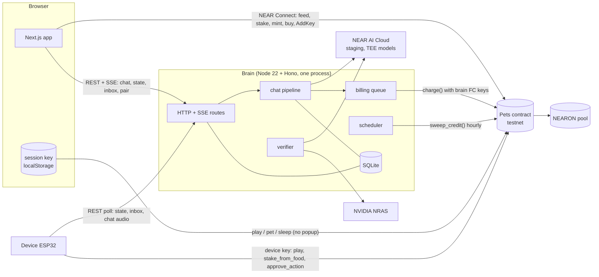
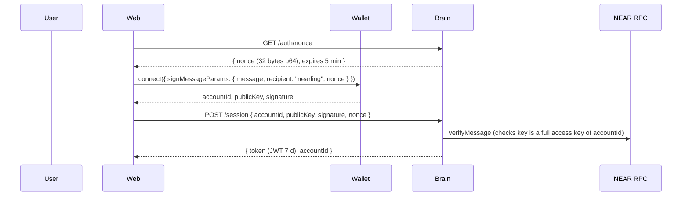
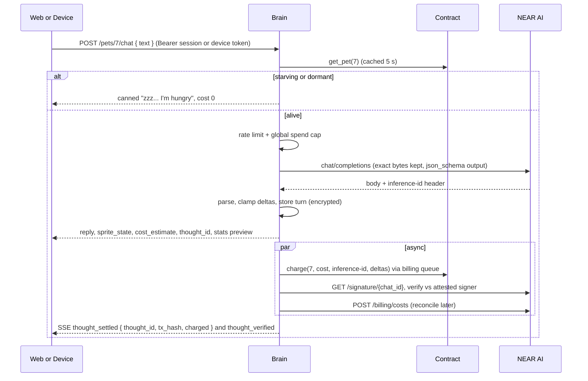

# 02. System architecture (web + brain focus)

## 1. Who owns what

| Data | Source of truth | Cached in | Why |
|---|---|---|---|
| Owner, budget (credit, food), stake, stats, stage, xp, traits, items, device key, approval mode | **Pets contract** | Brain `pet_cache` (5 s TTL) | CLAUDE.md 4: on-chain is truth |
| Conversation turns, memory summary, facts | **Brain DB** (encrypted) | none | Private, never on chain |
| Inbox (proactive messages) | Brain DB | Web memory | Off-chain, cheap |
| Per-reply cost, inference id, verification result | Brain DB (`thoughts` table) | Web | The `thought` event on chain carries cost + `usage_ref` only |
| Sessions, device tokens, pairing codes | Brain DB | Web `localStorage`, device flash | |
| Pet timeline (fed by X, staked, stage up, owner changes) | Chain events | Brain `pet_events` | nfts track "history per NFT" |

Rule of thumb: **the web writes value to the chain directly through the wallet; everything AI goes through the brain.** The brain never holds user funds and never signs for users.

## 2. Component diagram



## 3. Key sequences

### 3.1 Sign in (one popup)



### 3.2 Chat turn (no popup, pet pays)



The reply is returned **before** the charge lands (CLAUDE.md 8.3 step 5). The UI shows the cost immediately as "billing..." and flips to the real tx link when SSE says settled. That is the "pet visibly pays for each thought" moment.

### 3.3 Feed (wallet popup, by design)

Web calls `feed(pet_id)` with deposit through NEAR Connect. On success the web refetches `/pets/:id/state`; the brain's event tail later adds "fed by alice.testnet 0.5 NEAR" to the timeline. Any account can feed (good for the public pet page: "feed this pet").

### 3.4 Proactive message

Scheduler (every 15 min) loads all pets, evaluates triggers (03-brain-design, section 8), writes an inbox row, pushes SSE `inbox` to open web tabs; the device sees it on its next 20 s poll and chimes.

## 4. Deployment

| Piece | Where | Why |
|---|---|---|
| Web | Vercel (Next.js) | Free, preview URLs, judges get a hosted demo |
| Brain | Fly.io or Railway, **one** machine with a persistent volume for SQLite | Needs a long-running process (scheduler, SSE, billing queue). One instance keeps rate limits and nonces simple |
| Local dev | `pnpm --filter brain dev` + `pnpm --filter web dev`, `MOCK_AI=1` for tests only | Judges can run both locally with `.env` |

Brain must be HTTPS for the device (Fly gives TLS). CORS: allow the web origin and `localhost:3000`.

Why not Next.js API routes for the brain: serverless functions cannot run the 15-minute scheduler, hold SSE connections cheaply, or keep a serial nonce queue. A separate Hono service is the right call (and is what CLAUDE.md already says).

## 5. Environment variables (brain)

```
NEAR_NETWORK=testnet
NEAR_RPC_URLS=https://test.rpc.fastnear.com,https://rpc.testnet.near.org
PETS_CONTRACT_ID=pets.<team>.testnet
BRAIN_ACCOUNT_ID=brain.<team>.testnet
BRAIN_KEYS=ed25519:...,ed25519:...,ed25519:...   # function-call keys, see 03 section 6.4
NEARAI_BASE_URL=https://cloud-stg-api.near.ai/v1
NEARAI_API_KEY=sk-...
NEARAI_CHAT_MODEL=openai/gpt-oss-120b
NEARAI_STT_MODEL=openai/whisper-large-v3
MEMORY_MASTER_KEY=<32 bytes base64>
SESSION_JWT_SECRET=<32 bytes base64>
WEB_ORIGIN=https://nearling.vercel.app
GLOBAL_DAILY_SPEND_CAP_USD=5
MOCK_AI=0
```

Web: `NEXT_PUBLIC_BRAIN_URL`, `NEXT_PUBLIC_PETS_CONTRACT_ID`, `NEXT_PUBLIC_NEAR_NETWORK=testnet`, `NEXT_PUBLIC_WALLETCONNECT_PROJECT_ID` (optional).
