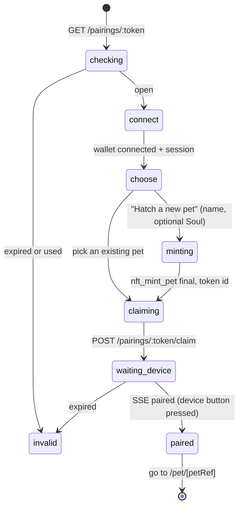

# 03. Pages and flows

Each section: purpose, layout, data, actions, done-when (from the Build Spec where it applies).

## 1. `/hatch?t=<token>` Hatch & Pair (Build Spec 1)



- Screens: "Nearling found" -> Connect Meteor -> "Hatch Mochi" (name field, Soul textarea with a default, 1 KB counter) or pet list -> "Press the button on your Nearling" with the pet sprite -> confetti.
- Existing pets list = `nft_tokens_for_owner` on pets (and demo, labelled).
- Done when: fresh device pairs; replacement device pairs an existing pet without minting; used or expired token shows "This code has expired. Restart pairing on your Nearling."

## 2. `/adopt` (no device)

Same mint step as Hatch, plus a contract choice: **Normal** (`pets-v8`, 0.2 NEAR) or **Demo speed** (`pets-demo`, 0.105 NEAR, starves in about 14 min, labelled). Ends on `/pet/[petRef]` with the browser Nearling.

## 3. `/pet/[petRef]` Pet home

```
+----------------------------------+
| Mochi . Baby . winged    [inbox] |
| [demo speed]                      |
|  +----------------------------+  |
|  |  NearlingScreen 240x240    |  |   browser Nearling (04)
|  |  sprite + shirt + emotion  |  |
|  +----------------------------+  |
|  Fuel  ##########----  22 thoughts|
|  [Hold to talk]  [Type]           |
|  [Pat] [Rock] [Shake] [Lights off]|   care (web-sim)
|  Chat log with receipt badges     |
|  [Feed] [Closet] [Soul] [Garden]  |
|  [Device] [Race] [Share]          |
+----------------------------------+
```

- Data: `GET /pets/:petRef/state` (poll 15 s) + SSE `/pets/:petRef/stream` for `fuel_charged`, `fuel_added`, `inbox`, `evolved`.
- Talk: see 04 section 4. Each reply bubble shows the emotion, text, audio play, fuel chip ("1 thought", then the tx link once `fuel_charged` arrives) and the receipt badge.
- Low Fuel: talk button replaced by "Out of fuel. Feed Mochi" -> `/feed/[petRef]`; care buttons still work (Build Spec 4).
- Care buttons post `/care` with `source: web-sim`; milestone dots show pat / rock / sleep; the third one plays the evolution animation and shows wings (Build Spec 5).
- Not owner: read-only view with Feed button (anyone can feed).

## 4. `/feed/[petRef]` Feed the Brain (Build Spec 3)

- Header: pet sprite, name, current fuel.
- Pack picker: Snack 20 / Meal 100 / Feast 200 thoughts (`GET /feed/packs`).
- Pay tabs (only enabled modes shown):
  - **NEAR wallet (testnet)**: `POST /orders` (mode direct) -> `feed(pet)` tx -> `POST /orders/:id/direct-tx` -> fuel rises.
  - **Other chain (NEAR Intents)**: `POST /orders` (mode live) -> show deposit address as QR + copyable text, asset and exact amount, quote deadline countdown -> `/order/[id]` polls. Banner "Paid on mainnet, fuel granted on testnet". Only enabled when the team turns live mode on (each live payment needs human approval).
  - **Simulated**: "Pay (simulated)" with the "simulated" label.
- `/order/[orderId]`: Payment pending -> Fed (+N thoughts, celebration) / Expired (get a new quote) / Refunded / Failed, each with plain copy. Refresh-safe: the page only reads order status.
- Done when: duplicate refreshes add fuel once (the brain guarantees it; the page never triggers a second feed).

## 5. `/receipt/[turnId]` (Build Spec 2)

```
Reply receipt
  Status: Model verified            (green) | Gateway verified (blue) | Unverified (amber, reason)
  Soul version: 2   [view Soul]
  Model: z-ai/glm-5.3-flash (private, runs in a TEE)
  Checks
    [ok] GPU attestation (NVIDIA), fresh nonce, 12 min ago
    [ok] Reply signed inside the TEE by 0x3f1a...c09
    [ok] Signature covers request hash 9b2e... and response hash 41ac...
    [--] Intel TDX quote: not checked in app
  Fuel: 1 thought . paid from food . tx 8Fh2...
  Voice: ElevenLabs (reply text sent to a third-party voice service)
  [Publish this receipt] (owner, opt-in)
```

Owner only unless published. `/pet/[petRef]/receipts` lists recent turns with status chips.

## 6. `/pet/[petRef]/closet` (Build Spec 5)

- No shirt: "Claim your free Nearling shirt" -> `shirts.claim()` 0.01 NEAR -> shirt card.
- Owned shirts from `GET /pets/:petRef/closet`; "Wear" / "Take off" -> `/closet/equip`; the browser Nearling redraws.
- Device equip is done with device buttons; this page reflects it.

## 7. `/pet/[petRef]/soul`

- Shows `get_soul` (version, prompt) and history from `soul_updated` events (timeline).
- Editor with 1 KB byte counter, preview note "Your pet's personality is public on NEAR".
- Save -> `set_soul` tx -> new version; the next reply's receipt shows it.

## 8. `/pet/[petRef]/garden` Brain Garden (Build Spec 9)

- Cards: Planted (staked NEAR), Credit growing (live ticker: `credit_micro + daily_credit_micro x elapsed`), Fuel ready (credit in thoughts), Self-sustaining badge.
- Actions: Plant (stake ≥ 1 NEAR), Unplant (unstake amount; shows "returns in 12 to 24 h"), Collect (withdraw after `unlock_epoch`; on failure "processing, retry later").
- Transfer warning: "While NEAR is planted, Mochi can't be given away."

## 9. `/approve/[approvalId]` Wallet actions (Build Spec 7, 8)

1. Load `GET /approvals/:id` (session must be the bound account).
2. Status `requested`: "Hold Approve on your Nearling first" (waits on SSE `approval_ready`).
3. Status `approved`: shows exactly what the device showed (kind, full destination, amount) and one button "Sign in Meteor".
4. Sign -> `POST /approvals/:id/submitted { tx_hash }` -> status `final` with explorer link; device shows the same.
5. Expired / rejected / already used: plain message, no button.

`/wallet` (P1): balances from `GET /wallet`, saved recipients editor (the device picks from these).

## 10. `/pet/[petRef]/transfer` (stretch, Build Spec 8)

Recipient field -> device approval (kind `transfer_pet`) -> `nft_transfer` signed in Meteor. Disabled with explanation when staked or unstaking (`E_STAKED`). After transfer: "Mochi's new owner can pair Mochi with their Nearling."

## 11. `/race`, `/race/[code]` (Build Spec 6)

- Create room -> code shown big + QR; or join by code.
- Lobby: both players, Ready buttons; countdown from the server `start_at`.
- Race: `RaceCanvas` (04 section 6), space bar / tap switches lanes.
- Result screen from the server `result` (win, lose, draw, interrupted).

## 12. `/p/[petRef]` public page

Server rendered: sprite with shirt and wings, name, stage, fuel meter, "Feed this pet" (anyone), last few receipts that the owner published, timeline (fed by, Soul versions, stage ups). OG image for the X demo post.

## 13. `/` landing

Hero pitch line, a live demo pet from `pets-demo` (watch fuel drop in real time), buttons "Try it in your browser" (`/adopt`) and "I have a Nearling" (explains scanning the QR), three-step how-it-works, privacy strip linking `/privacy`.
