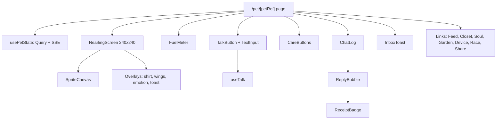

# 04. Components, state and rendering

## 1. Component tree (pet home)

## 2. State

| State | Where | Source |
|---|---|---|
| Pet state | TanStack Query `["pet", petRef]`, 15 s refetch | `GET /pets/:petRef/state` |
| Live events | `useStream(petRef)` EventSource | `GET /pets/:petRef/stream` (session token in query `?t=` because EventSource cannot set headers; short-lived token) |
| Chat log | Query `["turns", petRef]` + optimistic local bubbles | `/turns`, `/talk` |
| Wallet | `useNearWallet()` | NEAR Connect |
| Session | `SessionProvider` context | `localStorage` |
| UI only | component state | |

SSE events patch the query cache (`fuel_charged` updates the bubble and fuel, `fuel_added` celebrates, `inbox` shows a toast, `evolved` plays the animation). No global store library.

## 3. Browser Nearling (`NearlingScreen`)

The Build Spec asks for "a simulated Nearling screen" with "the same feature logic with simulated inputs in the browser". It is both the judge's way to play and the dev harness before firmware is ready.

- A 240 x 240 canvas scaled up with `image-rendering: pixelated`, framed like the device.
- Inputs mapped to the device's: Hold-to-talk button = device talk button; Pat = touch pad; Rock / Shake = motion; Lights off = light sensor (sleep after 5 s).
- Care logic: a small TS state machine in `packages/shared/care.ts` mirroring the firmware states (idle, perked, drowsy, dizzy, asleep) so web and device behave the same; events go to `/care`.
- Shows the same `display_state`, emotion tag, shirt layer and wings as the device.

## 4. Talk (`useTalk`)

1. Press: `navigator.mediaDevices.getUserMedia({ audio: true })`, `MediaRecorder` (WEBM/Opus), max 12 s, sprite shows **Listening**.
2. Release: sprite **Thinking**; create `request_id = crypto.randomUUID()`; POST multipart to `/talk` with `voice=1`.
3. On network error or timeout (25 s): retry once with the **same** `request_id` (brain returns the saved reply, no double debit).
4. Response: bubble with text, emotion -> sprite animation for 3 s, play `audio_url` if present (text stays if audio fails), fuel chip "1 thought . charging", receipt badge "verifying".
5. SSE `fuel_charged` -> chip shows tx; receipt badge updates when `/receipts/:turnId` is ready (poll 3 s, max 30 s).
6. Text input uses the same flow with JSON.
7. Mic permission denied -> text input only, with a hint.

## 5. Sprite renderer (`SpriteCanvas`)

- Inputs: `public/art/sprites.png` + `sprites.json` from the art owner (frame rects per stage, form and state; shirt and wing layers with anchors). Copied from `/art` by a prebuild script.
- `requestAnimationFrame` loop at the sheet fps; draw order body -> shirt -> wings -> emotion bubble -> particles.
- State selection: emotion tag for 3 s after a reply, else `display_state`, else idle.
- Until the sprite sheet lands: placeholder shapes with the same state names so pages are buildable.

## 6. Race client (`RaceCanvas`)

- Uses `packages/race` `simulate` step functions at 30 ticks per second on the server clock (`start_at` + offset from ping / pong).
- Local lane switch is instant; `lane` messages sent with the tick; opponent rendered from `opp_lane`.
- On crash: send `crash { tick, inputs }`; wait for `result`.
- Keyboard (space / arrows) and tap.

## 7. Server-rendered parts

- `/p/[petRef]` and `opengraph-image.tsx` fetch `GET /pets/:petRef/state` with `revalidate: 30`.
- `/privacy` fetches `GET /attestation` with `revalidate: 300`.
- Everything else is client side.

## 8. Accessibility and phone details

- Big touch targets (≥ 44 px), hold-to-talk supports touch and mouse, visible text for every audio reply.
- Works in Meteor's in-app browser; deep links back to the page after signing (NEAR Connect handles return).
- Respect `prefers-reduced-motion` for confetti and shake.
